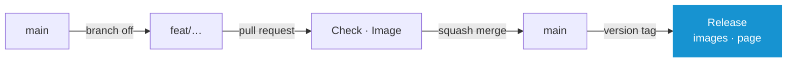

# Contributing

`main` is the only long-lived branch. Every change returns to it as one squash commit. A release is a version tag.

## Development

Install the tools:

```
sudo pacman -S --needed make rust shellcheck shfmt zsh yamllint actionlint zizmor \
    gettext diffutils gitleaks jq kbd terminus-font xkeyboard-config gjs libadwaita desktop-file-utils archiso systemd-ukify qemu-base edk2-ovmf tesseract tesseract-data-eng openssh
```

| Command | Does |
| --- | --- |
| `make check` | Runs the full gate, as in CI |
| `make fmt` | Formats with `cargo fmt` and `shfmt` |
| `make run` | Runs the Installer from source |
| `make run MODULE=recovery` | Runs the Recovery from source |
| `make run ARGS=--dry-run` | Runs without touching the machine |
| `make build` | Builds the program with every module embedded |
| `make iso` | Builds program, Recovery image and ISO |
| `make image` | Builds the images only, from the built program |
| `make smoke` | Boots both newest images and works their first page |
| `make e2e` | Installs the newest ISO, boots it, repairs it, boots again and rewrites the Recovery |
| `make e2e START=desktop` | Does the same with the Desktop profile, up to GNOME's login screen |
| `make clean` | Removes every build output |

**Note:** _CI installs the same packages and runs the same commands in an Arch container. A check that passes locally passes in CI._

### Layout

| Change | Place |
| --- | --- |
| Packages, tasks, questions | **[installer](../installer)** |
| Repair | **[recovery](../recovery)** |
| Functions for YAML and scripts | **[lib.sh](../lib.sh)**, checked by **[lib.check.sh](../lib.check.sh)** |
| Product name and look | **[product.yaml](../product.yaml)** |
| German translation | **[locales/de.po](../locales/de.po)** |
| Interface | **[runtime](../runtime)**, in Rust, with everything above embedded |
| ISO and Recovery image | **[iso](../iso)** |

## Workflow



1. **Branch off `main`** and name the branch after the change: `feat/wireless-settings`, `fix/helix-test`
2. **Open a draft pull request at once.** A branch is checked only through its pull request. Every push is built, booted and installed, which takes about 30 minutes
3. **Squash merge** or set auto-merge. The change lands once `Check` and `Image` pass, as one commit under the pull request's title. The branch is deleted

- Only the title reaches `main`, not the commits inside the branch
- A draft gets the same run and cannot be merged. Marking it ready starts no run
- A pull request that changes only `docs/`, Markdown or `LICENSE` is checked, but not built

### Title

The title is the one line `main` keeps. The release notes are read from it, so it follows **[Conventional Commits](https://www.conventionalcommits.org)**: type, colon, change.

| Title | Version | Release Page |
| --- | --- | --- |
| `fix: the Recovery finds a kernel on a separate /boot` | 2.0.0 → 2.0.1 | Bug Fixes |
| `feat: join a wireless network before the first download` | 2.0.0 → 2.1.0 | Features |
| `feat!: one answer file per module` | 2.0.0 → 3.0.0 | ⚠ BREAKING CHANGES |
| `docs:` `refactor:` `test:` `build:` `ci:` `chore:` | None | Nothing |

- The title is a short phrase for someone who installs or repairs a machine. The release notes capitalize it: `* The Recovery finds a kernel on a separate /boot`
- A title without a type lands under Other Changes
- The merge dialog shows the title and an empty description. Both stay as they are

**Note:** _A wrong title is corrected on the release page once it is published._

## Tasks

### Commands

Every command that changes a system goes through a helper in `lib.sh`. The helper shows the command and records it for `installer.sh`. **[➜ Script](../runtime/README.md#script)**

| Helper | For |
| --- | --- |
| `run` | A command: `run arch-chroot "$MNT" systemctl enable sshd.service` |
| `run_sh` | Shell text with a pipe or a redirection. A password is named by its variable: `"$ARCH_OS_PASSWORD"` |
| `write_file` | A file from stdin: `render … \| write_file "${MNT}/etc/hostname"`. `-a` appends |

- Checks, queries, messages, retries, waits and the clean-up of an earlier attempt stay plain shell. They are not part of the script
- A retried command is recorded once with `record` and confirmed with `confirmed`. `chroot_pacman_install` shows how
- A random value that a file names later, such as a UUID, is generated by the task and passed to the command. The script then holds the same value as the file
- A value that has to be fresh when the script runs, such as the expiry of a sudo rule, stays shell text for `run_sh`
- No command names a version that the next run may lack, such as a kernel's module folder

### Templates

Every file a task writes into the new system lies in `data/` beside `task.sh` and is named after its target. `render` from `lib.sh` fills it, and `where` returns the folder.

```
render "$(where)/locale.conf" LOCALE="$ARCH_OS_LOCALE_LANG" | write_file "${MNT}/etc/locale.conf"
```

- `{{NAME}}` is the only placeholder. It is filled from `NAME=value`, never from the environment, so every `$` reaches the file unchanged
- An unfilled placeholder, an unused value or a stray `{{` fails the task. Values are filled once, from left to right
- A file without placeholders goes through `render` too. A placeholder added later then cannot reach a disk unfilled
- `envsubst` is not used. It reads the environment, replaces an unset variable with nothing and, without a list of names, replaces every `${…}`
- Boot entry templates lie in `recovery/data/`, since the Recovery writes them again through `boot_entries`

A file goes into the drop-in directory of its program where one exists. These programs have none:

| File | How | Why |
| --- | --- | --- |
| `/etc/pacman.conf` | Edited | One `Include =` per file, see `pacman_include`. A glob stops pacman once it matches nothing |
| `/etc/locale.gen` | Edited | `locale-gen` reads nothing else, and a glibc update runs it again |
| `/etc/environment` | Edited | `pam_env` reads nothing else, and `sudo` takes the editor from it |
| `/etc/nsswitch.conf` | Edited | glibc reads nothing else |
| `/etc/gdm/custom.conf` | Written whole, only with automatic login | GDM reads nothing else |
| `/etc/xdg/reflector/reflector.conf` | Written whole | `reflector.service` names it on its command line and in its sandbox |

### Lint

`make lint` enforces these rules. It fails on:

- A rendered file redirected into place instead of piped to `write_file`
- A redirection into `${MNT}` or the home
- A `{ … } >"${MNT}/…"` block
- Any output of `desktop-file-validate` for a `.desktop` file, since the tool exits 0 on a warning

### Closing the Target

Closing means swap off, sync, unmount and lock. The Installer closes the target before partitioning, the Recovery before opening the disk. A second attempt therefore starts from whatever the first one left.

- `umount -R` is used, never `-A`. `-A` reaches beyond the target and, in the Recovery, would unmount the rollback's snapshots
- `fuser` runs with `-M`. Without it, a target that is no mount point resolves to the live system
- Whatever still holds the target is logged, then killed
- A step is done once it is on the disk. The Installer's last task and the Recovery's rollback and rebuild end with `sync`. Without it, a power cut leaves FAT with empty boot files

### Errors

| Kind | Example | Page shows |
| --- | --- | --- |
| Expected | No internet, wrong disk, damaged download | Headline and next step, translated |
| Broken script | A package Arch renamed, a tool with changed output | Module, task, script and line, function, command, exit code and output |

A script stops on an expected problem with `exit` and a status. The text for each status stands under `errors:` in `module.yaml`. **[➜ Stopping on Purpose](../runtime/README.md#stopping-on-purpose)**

| Status | Meaning |
| --- | --- |
| `3` | No internet |
| `4` | GitHub unreachable |
| `5` | AUR unreachable |
| `10` and up | Defined by the task or action that uses it |

## Translating

**The English sentence is the key.** Each language has one catalog, `locales/<code>.po`. It holds every text on screen, the runtime's and both modules'. A missing translation shows English, so a catalog works from its first entry.

- `make check` compares every catalog with every text. A text reworded in YAML or runtime fails until its entry follows. An unused entry fails too. The failing test lists both
- A placeholder such as `{{ARCH_OS_DISK}}` stays as it is, braces and name included. Blank lines between paragraphs stay too
- A text of several paragraphs is one entry: `msgid ""`, then one line per paragraph, with `\n` as in the file

### Adding a Language

```
cp locales/de.po locales/fr.po
```

Translate every `msgstr` and open a pull request. The language appears on the first page once its catalog exists.

- `msgid "English"` gets the language's own name: `Deutsch`, `Français`
- A `msgstr` left in English shows English

**Note:** _The console draws only Latin with accents, Greek and Cyrillic. Open an issue before starting on another script. **[➜ Console Glyphs](../iso/README.md#console-glyphs)**_

## Docs Images

The images are generated, so none shows an outdated interface. CI never renders them. Run the commands by hand and commit the result with the change.

| Command | Renders |
| --- | --- |
| `make screenshots` | Every page in **[screenshots.yaml](screenshots.yaml)**, which lists pages and answers |
| `make banner` | The banner, from two screenshots and the tagline in `README.md` |
| `docs/svg.py` | Download button and requirements, with their alt texts in `README.md` |

- Rendering needs `chromium`, `imagemagick`, `python-fonttools`, `python-pyte`, `python-yaml` and `ttf-firacode-nerd`. It also needs systemd as PID 1, for `localectl` and `timedatectl`
- Every screenshot comes from a run with `--dry-run`
- The version in the footer is left out, so an image holds for every release
- `installing.png` captures a run in progress, so it differs every time

## CI

| Job | When | Does |
| --- | --- | --- |
| `Check` | Every pull request, Monday morning, manual run | `make check` |
| `Image` | Pull request that touches the image, version tag, Monday morning, manual run | Builds program, Recovery image and ISO and boots both. Installs, repairs and boots a Core. Starts its Recovery and rewrites it from the ISO |
| `Release` | Version tag | Checks the tag and writes the release notes |
| `Publish` | Version tag | Attaches the files `Image` booted to a draft page and publishes it |

- A merge into `main` starts no run, since its pull request passed `Check` and `Image` on the current `main`
- Pull requests read the build cache. Monday's run and a manual run on `main` write it. A version tag builds without it
- A Desktop is also installed on Monday and on a manual run (**Run workflow** in the Actions tab). Locally, `make e2e START=desktop` does it

## Release

A version tag on an up-to-date `main` releases. The run builds and boots the images as that version, attaches them to the release page and publishes the page. The notes and their checks come from **[murkl/workflows](https://github.com/murkl/workflows)**, checked out next to this project:

```
../workflows/notes/notes.sh 2.1.0 && git tag 2.1.0 && git push origin 2.1.0
```

- `fix:` raises the patch version, `feat:` the minor and `feat!:` the major. A release is a decision, not a schedule
- The page carries `arch-os-2.1.0-x86_64.iso` and `arch-os-2.1.0-recovery-x86_64.tar`, each with its sha256 on GitHub. The ISO contains the Recovery. An installed Recovery updates itself from the `.tar`
- Every other build carries a pre-release of the patch after the last tag: `arch-os-2.0.1-dev-x86_64.iso`. `make build VERSION=2.1.0` stamps any version into the program

**Note:** _The page stays a draft until every file is attached. After a failed run, run its failed jobs again. Tags never move, so a fix after a release is a new version._

## Repository Settings

The GitHub settings live in **[.github/settings/](../.github/settings)**. An admin logged in with `gh` applies them, with **[murkl/workflows](https://github.com/murkl/workflows)** checked out next to this project:

```
make github
```

| File | Content |
| --- | --- |
| `repository.json` | Description. Squash merges only, under the pull request title. Auto-merge, merged branches deleted. Secret scanning with push protection |
| `ruleset-main.json` | Only a pull request that passed `Check` and `Image` reaches `main`, squashed. No force push, no deletion |
| `ruleset-tags.json` | No tag is moved or deleted |
| `actions.json` | Workflow tokens are read-only unless the workflow grants more |
| `topics.json` | Repository topics |

- Run it again after changing a file. It also enables Dependabot alerts and private vulnerability reporting
- `ruleset-main.json` names the project's checks. `topics.json` is optional
- CodeQL is not used. In `make check`, zizmor checks the workflows and clippy the runtime
