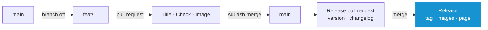

# Contributing

`main` is the only long-lived branch. Every change returns to it as one squash commit, a release is one more pull request.

## Development

```
make check                   # full gate, as in CI
make fmt                     # format with cargo fmt and shfmt
make run                     # Installer from source
make run MODULE=recovery     # Recovery from source
make run ARGS=--dry-run      # without touching the machine
make build                   # program with every module embedded
make iso                     # program, Recovery image and ISO
make image                   # images only, from the built program
make smoke                   # boot both newest images, work their first page
make e2e                     # install the newest ISO, boot, repair, boot, rewrite the Recovery
make e2e START=desktop       # the same with the Desktop profile, up to GNOME's login screen
make clean                   # remove every build output
```

```
sudo pacman -S --needed make rust shellcheck shfmt zsh yamllint actionlint zizmor \
    gettext diffutils gitleaks jq kbd terminus-font xkeyboard-config archiso systemd-ukify qemu-base edk2-ovmf tesseract tesseract-data-eng openssh
```

**Note:** _CI installs the same packages and runs the same commands in an Arch container: green locally is green in CI._

### Layout

| Change | Place |
| --- | --- |
| Packages, tasks, questions | **[installer](../installer)** |
| Repair | **[recovery](../recovery)** |
| Functions for YAML and scripts | **[lib.sh](../lib.sh)**, checked by **[lib.check.sh](../lib.check.sh)** |
| Product name and look | **[product.yaml](../product.yaml)** |
| German translation | **[locales/de.po](../locales/de.po)** |
| ISO and Recovery image | **[iso](../iso)** |
| Interface | **[runtime](../runtime)**, in Rust, with everything above embedded |

## Tasks

### Templates

Every file a task writes into the new system lies in `data/` beside `task.sh`, named after its target. `render` from `lib.sh` fills it, `where` names the folder.

```
render "$(where)/main.conf" KERNEL="$KERNEL" CMDLINE="$cmdline" >"${MNT}/boot/loader/entries/main.conf"
```

- `{{NAME}}` is the only placeholder, filled from `NAME=value`, never from the environment. Every `$` stays for the reader of the file
- An unfilled placeholder, an unused value and a stray `{{` fail the task. Values fill once, left to right
- A file without placeholders goes through `render` too, so a placeholder added later cannot reach a disk unfilled
- No `envsubst`: it reads the environment, fills unset variables with nothing, and without a name list fills every `${…}`
- Boot entry templates lie in `recovery/data/`, since the Recovery writes them again through `boot_entries`
- `make lint` fails on a `{ … } >"${MNT}/…"` block

A file goes into the program's drop-in directory where one exists. These have none:

| File | How | Why |
| --- | --- | --- |
| `/etc/pacman.conf` | Edited | One `Include =` per file, see `pacman_include`. A glob stops pacman once it matches nothing |
| `/etc/locale.gen` | Edited | `locale-gen` reads nothing else, and a glibc update runs it again |
| `/etc/environment` | Edited | `pam_env` reads nothing else, and `sudo` takes the editor from it |
| `/etc/nsswitch.conf` | Edited | glibc reads nothing else |
| `/etc/gdm/custom.conf` | Written whole, only with automatic login | GDM reads nothing else |
| `/etc/xdg/reflector/reflector.conf` | Written whole | `reflector.service` names it on its command line and in its sandbox |

### Closing the Target

Swap off, sync, unmount, lock: in the Installer before partitioning, in the Recovery before opening the disk. A second attempt starts from what the first left.

- `umount -R`, never `-A`, which reaches beyond the target and in the Recovery would unmount the rollback's snapshots
- `fuser -M`, without which a target that is no mount point resolves to the live system
- Whatever still holds the target is logged, then killed
- Done means on the disk: the Installer's last task and the Recovery's rollback and rebuild end with `sync`, or a power cut leaves FAT with empty boot files

### Errors

| Kind | Example | Page |
| --- | --- | --- |
| Expected | No internet, wrong disk, damaged download | Headline and next step, translated. Nothing to share |
| Broken script | A package Arch renamed, a tool with changed output | Module, task, line, function, command, output, and **Share the log** |

A script stops on an expected problem with `exit` and a status, worded under `errors:` in `module.yaml`: `3` no internet, `4` GitHub unreachable, `5` AUR unreachable. Statuses from `10` up belong to the task or action using them. **[➜ Stopping on Purpose](../runtime/README.md#stopping-on-purpose)**

## Translating

**The English sentence is the key.** One catalog per language, `locales/<code>.po`, holds every text on screen, the runtime's and both modules'. A missing translation shows English, so a catalog works from its first entry.

- `make check` holds every catalog to every text. A text reworded in YAML or runtime fails until its entry follows, as does an unused entry. The failing test lists them
- `{{ARCH_OS_DISK}}` stays as is, braces and name, and so do the blank lines between paragraphs
- A text of several paragraphs is one entry: `msgid ""`, then one line per paragraph, with `\n` as in the file

### Adding a Language

```
cp locales/de.po locales/fr.po
```

Translate every `msgstr` and open a pull request. The language appears on the first page once its catalog exists.

- `msgid "English"` becomes the language's own name: `Deutsch`, `Français`
- A `msgstr` left in English shows English

**Note:** _The console draws only Latin with accents, Greek and Cyrillic, so open an issue before starting on another script. **[➜ Console Glyphs](../iso/README.md#console-glyphs)**_

## Docs Images

Generated, so none shows an outdated interface. CI never renders them: run them by hand and commit the result with the change.

```
make screenshots VERSION=2.1.0   # every page in screenshots.yaml, showing that version
make banner                      # banner from two screenshots and the tagline in README.md
docs/svg.py                      # download button and requirements, with their alt texts in README.md
```

- Without `VERSION` the screenshots show the next patch's pre-release. Name the target release, so `main` shows it
- Needs `chromium`, `imagemagick`, `python-fonttools`, `python-pyte`, `python-yaml` and `ttf-firacode-nerd`, and systemd as PID 1 for `localectl` and `timedatectl`
- Every run uses `--dry-run`. Pages and answers are listed in **[screenshots.yaml](screenshots.yaml)**
- `installing.png` captures a run in progress, so it differs every time

## Workflow



1. **Branch off `main`**, named after the change: `feat/wireless-settings`, `fix/helix-test`
2. **Open a draft pull request at once.** A branch is checked only through its pull request. Every push is built, booted and installed, about 30 minutes
3. **Squash merge** or auto-merge. It lands once `Check`, `Image` and `Title` pass, as one commit under its title, and the branch is deleted

- Only the title reaches `main`, not the commits inside the branch
- A draft gets the same run and cannot be merged. Marking it ready starts nothing
- A pull request that changes only `docs/`, Markdown or `LICENSE` is checked, never built

## Title

The one line `main` keeps. Version and changelog are read from it, so it follows **[Conventional Commits](https://www.conventionalcommits.org)**: type, colon, change.

| Title | Version | Release Page |
| --- | --- | --- |
| `fix: the Recovery finds a kernel on a separate /boot` | 2.0.0 → 2.0.1 | Bug Fixes |
| `feat: join a wireless network before the first download` | 2.0.0 → 2.1.0 | Features |
| `feat!: one answer file per module` | 2.0.0 → 3.0.0 | ⚠ BREAKING CHANGES |
| `docs:` `refactor:` `test:` `build:` `ci:` `chore:` | none | nothing |

- Written for someone installing or repairing a machine. `Title` fails without a type and checks again on every edit
- The merge dialog shows the title and an empty description. Both stay, except for two lines in the description:
  - `BREAKING CHANGE: …` puts the required action on the release page
  - `Release-As: 3.0.0` sets a chosen version

**Note:** _A wrong title is corrected after the merge in the description of the merged pull request. The next release run reads this instead of the commit:_

```
BEGIN_COMMIT_OVERRIDE
fix: the corrected line
END_COMMIT_OVERRIDE
```

## CI

| Job | When | Does |
| --- | --- | --- |
| `Title` | Pull request opened, pushed or edited | Checks title and base branch |
| `Check` | Every pull request | `make check` |
| `Image` | Pull request touching the image, release, Monday morning, manual | Builds program, Recovery image and ISO, boots both, installs, repairs and boots a Core, then starts its Recovery and rewrites it from the ISO. Monday and manual runs also install a Desktop |
| `Release` | Push to `main` | Release pull request, or after its merge the tag and the draft page |
| `Publish` | Release | Attaches the files `Image` booted and publishes the page |

- A merge into `main` runs only `Release`: its pull request passed `Check` and `Image` already
- Desktop runs: Monday, **Run workflow** in the Actions tab, locally `make e2e START=desktop`

## Release

Nothing is typed or tagged by hand.

1. **Every releasing merge** opens or updates `chore(main): release 2.1.0`. It raises the version in `.release-please-manifest.json` and in the badge of **[README.md](README.md)**, and writes the version's section of **[CHANGELOG.md](../CHANGELOG.md)**
2. **Merging it releases.** The run on `main` tags `2.1.0`, builds and boots the images as that version, attaches them to the release page and publishes it

- Merges collect in the release pull request until it is merged. Releasing is a decision, not a schedule
- Release pull request, tag and page use the secret `RELEASE_TOKEN` of the environment `release`, limited to `main`: a fine-grained personal access token with Contents and Pull requests read and write, stored by `.github/release-token.sh`. The workflow token cannot do this, since GitHub holds the checks of a bot's pull request until someone approves its runs. An expired token fails `Release`
- The page carries `arch-os-2.1.0-x86_64.iso` and `arch-os-2.1.0-recovery-x86_64.tar`, each with its sha256 on GitHub. The ISO carries the Recovery, an installed Recovery updates itself from the `.tar`
- Every other build carries a pre-release of the next patch: `arch-os-2.0.1-dev-x86_64.iso`. `make build VERSION=2.1.0` stamps any version into the program

**Note:** _The page stays a draft until every file is attached. After a failed run, re-run its failed jobs._

## Repository Settings

The GitHub settings live in **[.github/settings/](../.github/settings)**, applied by an admin logged in with `gh`:

```
make github
```

| File | Content |
| --- | --- |
| `repository.json` | Description. Squash merges only, under the pull request title. Auto-merge, merged branches deleted. Secret scanning with push protection |
| `ruleset.json` | Only a pull request that passed `Check`, `Image` and `Title` reaches `main`, squashed. No force push, no deletion |
| `actions.json` | Workflow tokens read-only unless the workflow grants more |
| `topics.json` | Repository topics |

- Run it again after changing a file. It also enables Dependabot alerts and private vulnerability reporting
- Identical in every project released this way. `ruleset.json` names the project's checks, `topics.json` is optional
- No CodeQL: its only language here would be the workflows, which zizmor checks in `make check`
