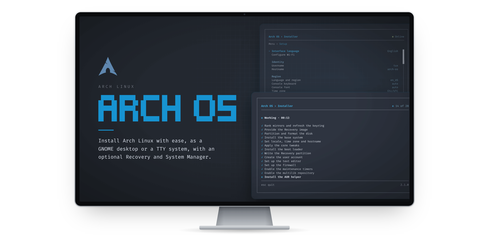
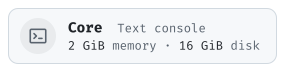
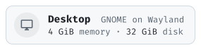
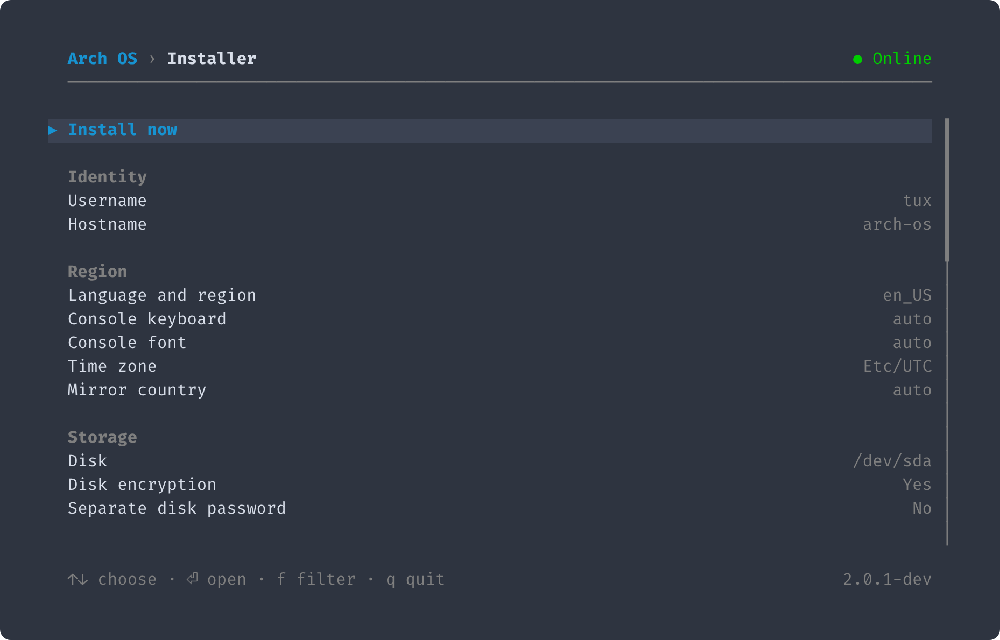
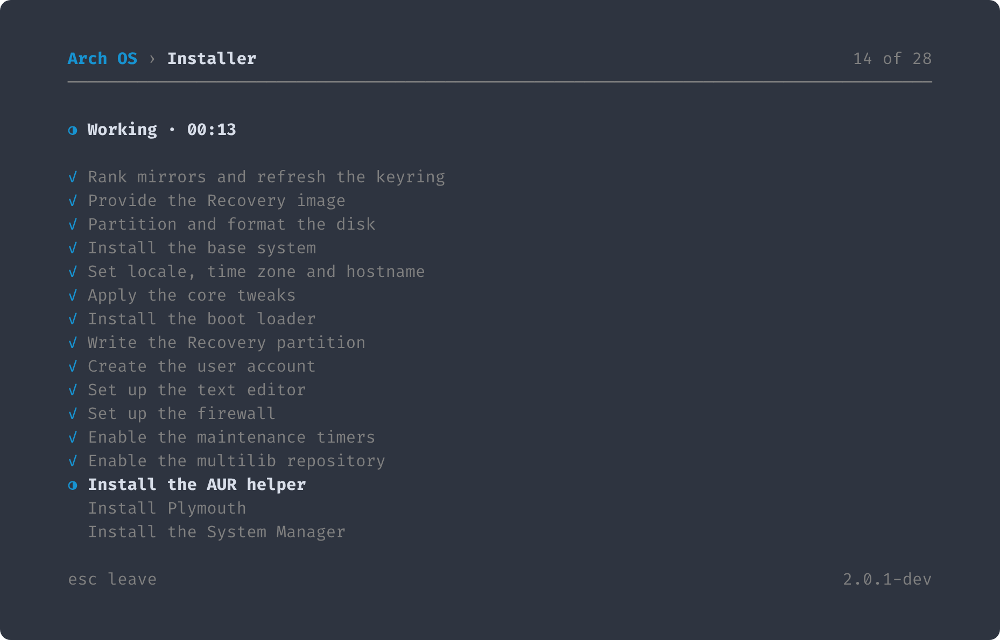

<div align="center">



<h3>Install Arch Linux with ease, as a desktop or a TTY system, with a Recovery and a&nbsp;System&nbsp;Manager.</h3>

<p>
  <a href="https://github.com/murkl/arch-os/releases/latest"></a>
  <br>
  <picture><source media="(prefers-color-scheme: dark)" srcset="requirements/core-dark.svg"></picture>
  <picture><source media="(prefers-color-scheme: dark)" srcset="requirements/desktop-dark.svg"></picture>
</p>

**[➜ Reference](REFERENCE.md)** · **[➜ Contributing](CONTRIBUTING.md)** · **[➜ Telegram](https://t.me/archos_community)**

<p>
  <a href="https://github.com/murkl/arch-os/releases/latest"></a>
  <a href="../LICENSE"></a>
</p>

</div>

## Features

- Minimal Arch Linux base: linux-zen, btrfs, systemd-boot
- Disk encryption and Secure Boot with your own keys
- Btrfs snapshots before every package change
- Recovery on its own partition, rollback included
- Falls back on its own: fallback image, then the Recovery
- GNOME on Wayland or a text console, graphics drivers detected
- Desktop extras or a slim GNOME, Flatpak
- Browser, backup app and text editor of your choice
- AUR helper, 32-bit support, containers, firewall, SSH
- Zram, an out-of-memory guard and tuned defaults for older machines
- Works offline: no timer fails without internet
- [Bootsplash](https://github.com/murkl/plymouth-theme-arch-os), [Arch OS Manager](https://github.com/murkl/arch-os-manager), Shell Enhancement
- English and German

## Installation

1. Write the **[latest ISO](https://github.com/murkl/arch-os/releases/latest)** to a USB device with any ISO writer, or on any Linux:
   ```sh
   curl -Ls https://bit.ly/archos | bash
   ```
2. Set the firmware to UEFI and switch Secure Boot off
3. Boot the USB device, choose a starting point, then **Start**. It needs the internet, by cable or Wi-Fi
4. After the first start, **[switch Secure Boot on](REFERENCE.md#switching-it-on)**

<p align="center"><br><sub><b>Setup</b> · every answer prefilled and changeable</sub></p>

<p align="center"><br><sub><b>Installation</b> · each step as it runs</sub></p>
