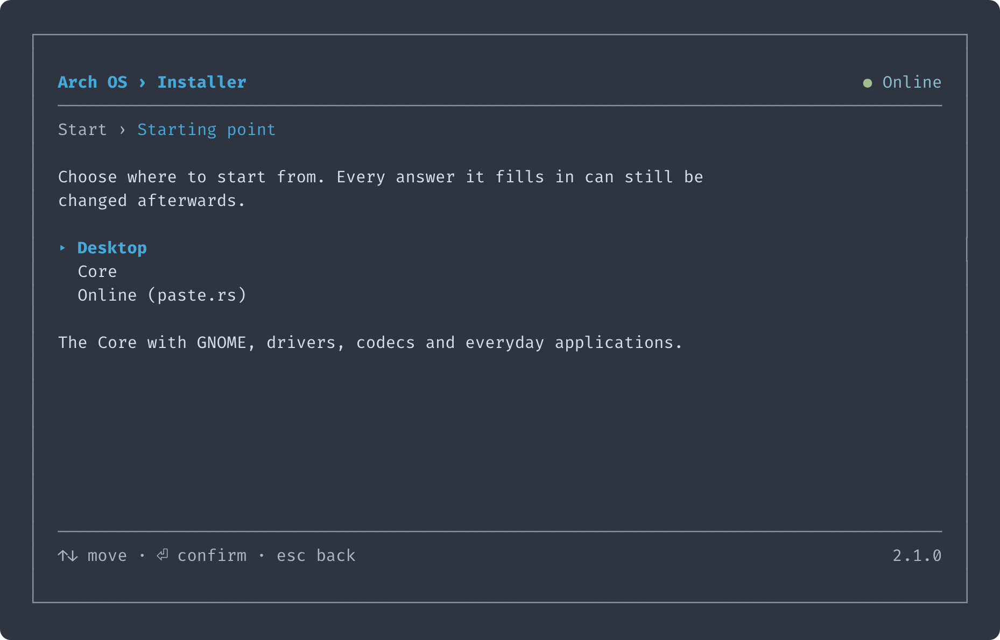

<div align="center">


<p>
  
  
</p>

<p><b>Install Arch Linux with ease, as a desktop or a TTY system.</b></p>

</div>

## Features

- Minimal Arch Linux base: linux-zen, btrfs, systemd-boot
- Disk encryption and Secure Boot with your own keys
- Btrfs snapshots before every package change
- Recovery on its own partition, rollback included
- Falls back to the previous image, then to the Recovery
- GNOME on Wayland or a text console, graphics drivers detected
- Desktop extras or a slim GNOME, Flatpak
- Browser, backup app and text editor of your choice
- AUR helper, 32-bit support, containers, firewall, SSH
- Zram, an out-of-memory guard and tuned defaults for older machines
- Works offline: no timer fails without internet
- [Bootsplash](https://github.com/murkl/plymouth-theme-arch-os), [Arch OS Manager](https://github.com/murkl/arch-os-manager), Shell Enhancement
- English and German

## Requirements

| | Core | Desktop |
| --- | --- | --- |
| Processor | x86_64 with UEFI | x86_64 with UEFI |
| Memory | 2 GiB | 4 GiB |
| Disk | 16 GiB | 32 GiB |

## Installation

1. Write the **[latest ISO](https://github.com/murkl/arch-os/releases/latest)** to a USB device with any ISO writer, or on any Linux:
   ```sh
   curl -Ls https://bit.ly/archos | bash
   ```
2. Set the firmware to UEFI and switch Secure Boot off
3. Boot the USB device, choose the **Installer** and a starting point, then **Start**. It needs the internet, by cable or Wi-Fi
4. After the first start, **[switch Secure Boot on](REFERENCE.md#switching-it-on)**



**[➜ Reference](REFERENCE.md)** · **[➜ t.me/archos_community](https://t.me/archos_community)**
