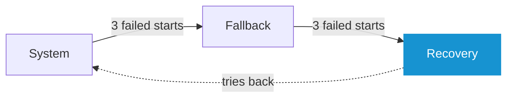

# Reference

How to start Arch OS, what it puts on a disk and why. What a module may declare and how its scripts run: **[➜ Runtime](../runtime/README.md)**.

## Starting Arch OS

The Arch OS ISO starts the Installer automatically. On another console (**Ctrl+Alt+F2**), `arch-os installer` or `arch-os recovery` opens either.

### The Boot Medium

The ISO is hybrid: it carries its own partition table and boot paths and works with any USB writer. On Linux, one command writes the latest:

```
curl -fsSL https://raw.githubusercontent.com/murkl/arch-os/main/get.sh | sh
```

- An ISO of that release in `DOWNLOAD_DIR`, `XDG_DOWNLOAD_DIR` or `~/Downloads` is reused, otherwise downloaded there
- A missing or mismatched checksum needs confirmation, so a self-built ISO can still be written
- Only USB sticks not in use by the running system are offered, checked again right before writing. Root only for `umount`, `dd` and `blockdev`

### Reusing Answers

Every answer except the passwords is saved to `installer.conf` right away, so an interrupted run resumes.

| Way | How |
| --- | --- |
| Share | **Share the configuration** on the last page uploads the answers to **[paste.rs](https://paste.rs)**. Another installation loads them with the **Online (paste.rs)** profile and asks only for the disk and the passwords |
| Copy | `installer.conf` beside the Installer on another machine |

**Note:** _A shared configuration leaves out the disk and the kernel parameters. Both belong to one machine, and a stranger's kernel parameters could open a root shell at boot._

## Disk

UEFI only, GPT, and the whole disk: Arch OS is the only system on it.

### Partitions

| Partition | Size | Type | Label | Mounted |
| --- | --- | --- | --- | --- |
| 1 | 1 GiB | EFI system (`ef00`) | `BOOT` | `/boot`, `fmask=0077,dmask=0077` |
| 2 | the rest | Linux x86-64 root (`8304`) | `BTRFS` | `/` |
| 3 | 1 GiB, twice the image | Linux (`8300`) | - | never, **[➜ The Recovery Partition](#the-recovery-partition)** |

- The root uses the partition type from the **[Installation guide](https://wiki.archlinux.org/title/Installation_guide#Example_layouts)**, so systemd's tools find it
- Partition 3 exists only with **Recovery** on and sits at the end, so the root is always partition 2
- **Encryption:** LUKS2 on partition 2, opened as `cryptroot`, with the account password or a separate one. **[➜ Accounts](#accounts)**
- **TRIM:** `--allow-discards --persistent` in the LUKS2 header lets `fstrim.timer` work without a kernel parameter. It reveals which blocks are free, not what is in them. **[➜ Arch Wiki](https://wiki.archlinux.org/title/Dm-crypt/Specialties#Discard/TRIM_support_for_solid_state_drives_(SSD))**

### Btrfs Subvolumes

| Subvolume | Mounted | Why it is separate |
| --- | --- | --- |
| `@` | `/` | The system. A rollback replaces it |
| `@home` | `/home` | Your files, untouched by a rollback |
| `@snapshots` | `/.snapshots` | Holds the snapshots |
| `@log` | `/var/log` | Logs that show why a rollback was needed |
| `@cache` | `/var/cache` | The package cache: large, and not needed in a snapshot |
| `@tmp` | `/var/tmp` | Scratch space, `chmod 1777` before systemd-tmpfiles runs |

- A rollback keeps all six, since a snapshot of `@` leaves out every nested subvolume. One created inside `@` later, such as a container image, moves to the new `@`
- Mounted with `defaults,noatime,compress=zstd:1`, as on Fedora. Level 1 costs an older processor far less per write than 3 and compresses almost as well. **[➜ Arch Wiki](https://wiki.archlinux.org/title/Btrfs#Compression)**
- The layout is defined once, in `lib.sh`. The Installer creates every subvolume, the Recovery opens only a disk that has all of them and leaves any other untouched

## The Boot Chain

systemd-boot starts the system, its fallback and the Recovery. With **Secure Boot** each entry starts a unified kernel image signed with this machine's own keys.

| Part | How | Why |
| --- | --- | --- |
| Loader | `bootctl install`, run from the live system, its firmware entry first in the boot order | In a chroot, `bootctl` cannot write a working firmware entry |
| Images | `/boot/EFI/arch-os/` | In `EFI/Linux` the loader would list each twice |
| Menu | Hidden, shown while **Space** is held | On some firmware the key arrives too late, so the Recovery is also in the firmware's boot menu |
| Order | `sort-key arch` and `arch-fallback` | The system first, its fallback second. The Recovery sorts by its `os-release` ID |
| Command line | `kernel_args` in the `bootloader` task | One source for the images and the entries |
| Editor | Off | An editable command line gives a root shell without any password. **[➜ Arch Wiki](https://wiki.archlinux.org/title/Systemd-boot#Loader_configuration)** |

**Note:** _Firmware entries of the disk's previous systems are removed with its partitions. Entries for other disks stay._

### When the System Does Not Start

Each entry gets three tries, then the loader starts the next. The fallback includes every kernel module. No key press, USB stick or network is needed. **[➜ Automatic Boot Assessment](https://systemd.io/AUTOMATIC_BOOT_ASSESSMENT/)**



- A start takes a try off the entry's name: `main+3.conf` becomes `main+2-1.conf`, and `main+0-3.conf` sorts last
- A start counts as good once the disk is mounted and, with GNOME, the login screen or session is up (`boot-complete.target`). `systemd-bless-boot` marks the entry, `arch-os-boot-tries.service` restores the tries of both entries
- `loader.conf` sets no `default`, since a default entry starts however often it failed. The Installer and the Recovery clear one left in the firmware
- An interrupted start counts as failed, such as powering off at the password prompt
- `panic=10` restarts after a kernel panic, so a system that panics on every start reaches the Recovery automatically
- With GNOME, `arch-os-session-up.service` waits up to 5 minutes for the session. Without a session the start does not count

### Kernel Parameters

| Parameter | Why |
| --- | --- |
| `rd.luks.name=…=cryptroot` | Opens the disk in `sd-encrypt` |
| `rootflags=subvol=@ rootfstype=btrfs` | Which subvolume is root |
| `zswap.enabled=0` | Interferes with zram |
| `panic=10` | A panic counts as a failed start |
| `nowatchdog` | With Core tweaks: unused, and it delays shutdown |
| `quiet splash loglevel=3 …` | **[Silent boot](https://wiki.archlinux.org/title/Silent_boot)**. `vt.global_cursor_default=0` hides the cursor, `/etc/issue.d/cursor.issue` shows it again at each login |
| `plymouth.ignore-serial-consoles` | Every virtual machine has a serial console, which switches Plymouth to text mode, password prompt included |
| `plymouth.use-simpledrm=0` | With encryption: the password prompt waits for the graphics driver instead of appearing twice. **[➜ Arch Wiki](https://wiki.archlinux.org/title/Plymouth#Using_SimpleDRM)** |
| `plymouth.splash-delay=3` | With encryption: the splash appears with the password prompt, not seconds earlier. **[➜ Arch Wiki](https://wiki.archlinux.org/title/Plymouth#Show_delay)** |

### The Initramfs

```
base systemd keyboard autodetect microcode modconf kms sd-vconsole block [sd-encrypt] filesystems
```

| Hook | Why |
| --- | --- |
| `keyboard` before `autodetect` | Includes every keyboard driver, not only the one in use during the installation |
| `microcode` | The processor's microcode, `intel-ucode` or `amd-ucode` from `/proc/cpuinfo` |
| `kms` | Plymouth needs a driver to draw on. It adds the open graphics drivers |
| No `fsck` | `fsck.btrfs` does nothing at boot |

**Note:** _The hooks are in `/etc/mkinitcpio.conf.d/10-arch-os.conf`, the boot splash extends it with `20-` and NVIDIA with `30-`. mkinitcpio's pacman hook rebuilds the image whenever the NVIDIA module changes._

### Secure Boot

Offered only with disk encryption. Without it the disk is readable anyway, and only a unified image signs kernel, initramfs and command line as one.

| When | What | Why |
| --- | --- | --- |
| First | The keys, with the boot images, before any snapshot | `/var/lib/sbctl` lives in `@`, and after a rollback to a snapshot without the keys nothing rebuilt could be signed. The Recovery keeps them across a rollback |
| Last | The chain signed | The NVIDIA driver and the boot splash rebuild the images earlier, outside sbctl's hooks |
| After | sbctl's hooks | Every new image is signed, and every update re-signs systemd-boot and the Recovery |

- `sbctl verify` lists `/boot/vmlinuz-*` as not signed on purpose: signed alone, the kernel would start with any initramfs written onto the EFI partition
- Keys enroll only in **setup mode**, which differs from "Secure Boot disabled". `-m` keeps Microsoft's certificates. A failure is logged and the machine still boots

#### Turning It On

After the installation and the first reboot, if **Secure Boot** was on among the answers:

| `sbctl status` shows | Do |
| --- | --- |
| `✓` | Restart and turn Secure Boot on in the firmware |
| `✗` | Clear the keys in the firmware (setup mode), run `sudo sbctl enroll-keys -m`, restart and turn it on |

## The System

The same base on every machine.

| Part | Choice | Why |
| --- | --- | --- |
| Kernel | `linux-zen` on every installation | One kernel means one set of problems to know. Tuned to stay responsive under load |
| Swap | zram, always | **[➜ Arch Wiki](https://wiki.archlinux.org/title/Zram)** |

### Tuning

Part of **Core tweaks**. They change behavior, never what is installed. **[➜ Arch Wiki](https://wiki.archlinux.org/title/Sysctl)**

| Setting | Why |
| --- | --- |
| `vm.dirty_bytes=256M`, `_background_bytes=64M` | With the default ratio, gigabytes are written in one burst |
| `vm.vfs_cache_pressure=50` | Directory entries are cheap to keep and costly to look up again |
| `transparent_hugepage/defrag=defer+madvise` | Pages at once, defragmented in the background |
| `DefaultTimeoutStopSec=15s` for the session's services | With the default, a hung service delays logout by 90 s. System services keep it, since a database stopped too early loses data |
| `SystemMaxUse=200M` | Otherwise the journal grows without limit |
| `bfq` on spinning disks | Keeps the system responsive while the disk seeks. Other disks keep the kernel's choice. **[➜ Arch Wiki](https://wiki.archlinux.org/title/Improving_performance#Changing_I/O_scheduler)** |
| `strict_limit=1`, `max_ratio=10` for USB drives | A copy no longer completes in memory and leaves the eject waiting. **[➜ Kernel](https://docs.kernel.org/admin-guide/abi-testing.html#abi-sys-class-bdi-bdi-strict-limit)** |
| `tcp_congestion_control=bbr`, `default_qdisc=fq` | Wi-Fi and long links lose packets without being full, which `cubic` treats as congestion |
| `tcp_mtu_probing=1` | Finds the smaller packet size of PPPoE or a tunnel when a router drops the ICMP message that reports it |
| `MAKEFLAGS` with one job per core, no debug package | AUR builds use every core and skip the debug package. No `-march=native`: binaries would fail on other hardware |

### Packages

Enough for a usable system, little enough to need no upkeep. Everything else follows an answer: the task that enables a service installs its package.

| Package | Why |
| --- | --- |
| `base`, `linux-zen`, `mkinitcpio`, `sudo`, `zram-generator`, `networkmanager`, `btrfs-progs`, `snapper` | The system itself |
| `dosfstools` | systemd checks the EFI partition at every boot. Boot counting writes there, and FAT keeps no journal |
| The chosen editor, `man-db`, `man-pages`, `openssh` | `base` includes none of them |
| `linux-firmware` | Left out in a virtual machine without a passed-through card: its drivers are in the kernel |

- A Wi-Fi network joined in the Installer becomes a NetworkManager connection, so the first boot is online. An 802.1X network must be joined again
- The graphics driver is detected in sysfs, card by card. Mesa always, with `vkd3d`, `mesa-utils` and `vulkan-tools`. **[➜ Arch Wiki](https://wiki.archlinux.org/title/Hardware_video_acceleration)**

| Card | Packages |
| --- | --- |
| Intel | `vulkan-intel`, `intel-media-driver` from Broadwell on, `libva-intel-driver` before |
| AMD | `vulkan-radeon`, `vulkan-mesa-layers`, `opencl-mesa` |
| NVIDIA from Turing on (`0x1e00`) | `nvidia-open-dkms` with headers, `nvidia-utils`, `nvidia-settings`, `opencl-nvidia`, `libva-nvidia-driver`, `nvidia-prime` alongside another card. **[➜ Arch Wiki](https://wiki.archlinux.org/title/NVIDIA)** |
| NVIDIA before Turing | `vulkan-nouveau`. Arch provides no NVIDIA driver for these |
| A virtual machine's adapter | Mesa alone, and the guest tools of its hypervisor |

**Note:** _With 32-bit support each driver gets its `lib32-` counterpart._

### Building from the AUR

`paru`, the boot splash theme and the System Manager come from the AUR. Each may fail without stopping the run: the AUR can be down for days, and nothing else needs them.

| Limit | Value | Why |
| --- | --- | --- |
| Attempts | 3 | Retries downloads, not a stuck build |
| Timeout | 45 min | Past this it is stuck, not slow |
| Compile jobs | 1 per GiB of memory, at most 1 per core | More would run a live system out of memory |

- Passwordless `sudo` only for the duration of the build. cargo's downloads stay in the build directory
- `paru` is built from source: a `-bin` package breaks the day Arch bumps `libalpm`

### The Text Editor

A small configuration in your home and root's, never in `/etc`. Only built-in features, nothing to update but the package.

| Editor | File | Beyond its defaults |
| --- | --- | --- |
| `nano` | `~/.config/nano/nanorc` | Line numbers, minibar, mouse, auto-indent, tabs of 4, soft wrap, `nano-syntax-highlighting` |
| `vim` | `~/.vim/vimrc` | `habamax`, `defaults.vim`, line numbers, 4 spaces, smart-case search |
| `neovim` | `~/.config/nvim/init.lua` | Line numbers, 4 spaces, smart-case search, persistent undo |
| `micro` | `~/.config/micro/settings.json` | `atom-dark`, 4 spaces, changes in the gutter, cursor and undo kept |
| `helix` | `~/.config/helix/config.toml` | `nord`, mode colors, bar cursor, tabs, indent guides, soft wrap |

**Note:** _`~/.vim/vimrc`, since Vim reads `~/.config/vim/` only where `XDG_CONFIG_HOME` is set._

## Accounts

One account, in `wheel`, with `sudo`. Root keeps the locked password Arch ships with: `sudo` grants the same rights, and the **[Recovery](#the-recovery)** opens a system that no longer starts.

| Answers | Disk | Login |
| --- | --- | --- |
| One password | Unlocked with your password | Automatic. `pam_gdm` passes the disk password to the keyring, which works only if it is the account password |
| Separate disk password | Its own password | The login screen, listing every account. For a shared machine |
| No encryption | Open | The login screen |

More accounts: **Settings ➜ System ➜ Users ➜ Add User**, where **Parental Controls** restricts one with Flatpak, or `sudo useradd -m <name>` and `sudo passwd <name>`. **[➜ Arch Wiki](https://wiki.archlinux.org/title/GNOME/Keyring#PAM_step)**

**Note:** _On a shared machine with one password, turn automatic login off in **Settings ➜ System ➜ Users**._

### The Keyring

If the keyring password differs from the login password, GNOME asks for it after login. Change it in **Passwords and Keys** (`sudo pacman -S seahorse`): **Login ➜ Change Password**.

| After | Keyring password |
| --- | --- |
| Changing the disk password, with automatic login | The new disk password |
| Changing the account password | The new account password |
| Turning automatic login on, with a separate disk password | The disk password |
| Turning automatic login off, with two passwords | The account password |

**Note:** _To change the disk password: `sudo cryptsetup luksChangeKey /dev/<partition>`, on the partition `lsblk -f` lists as `crypto_LUKS`._

## GNOME

Filtered, not installed and then trimmed: what **Slim desktop** leaves out is never downloaded.

| Part | What |
| --- | --- |
| App store | GNOME Software installs Flatpaks and, with `fwupd` from **Desktop extras**, firmware. No PackageKit, so only pacman changes the system. **[➜ Arch Wiki](https://wiki.archlinux.org/title/Pacman/Tips_and_tricks#Graphical)** |
| Bazaar | Replaces it when chosen with Flatpak, plus `gnome-firmware`, since Bazaar installs Flatpaks only. **[➜ Bazaar](https://apps.gnome.org/Bazaar/)** |
| Browser | In the system language: Firefox's `firefox-i18n-<lang>`, `hunspell-<lang>` for Firefox and GNOME Web, codecs for GNOME Web and Vivaldi. Default for every web link and pinned to the dock. **[➜ Arch Wiki](https://wiki.archlinux.org/title/Firefox)** |
| `.local` names | `nss-mdns` before the resolver in `/etc/nsswitch.conf`, so printers, shares and machines are reachable by name. **[➜ Arch Wiki](https://wiki.archlinux.org/title/Avahi#Hostname_resolution)** |
| GNOME Boxes | Works once installed: libvirt's session, KVM open to every account, disks in your home. A guest under QEMU gets `phodav` for shared folders. **[➜ GNOME Boxes](https://apps.gnome.org/Boxes/)** |
| Extensions | From **[extensions.gnome.org](https://extensions.gnome.org)** through `gnome-browser-connector`, managed in the **Extensions** app |
| File sharing | Your home and a public folder that guests can read and only you can write, announced under the hostname (`mdns name = mdns`) |
| Firmware | `fwupd-refresh.timer` keeps the catalog current wherever `fwupd` is installed, with **Desktop extras** or alongside GNOME Firmware. **[➜ Arch Wiki](https://wiki.archlinux.org/title/Fwupd)** |

### Out of Memory

`systemd-oomd` stops one app before GNOME freezes. GNOME runs each app in its own scope, so nothing else is affected. **[➜ Arch Wiki](https://wiki.archlinux.org/title/Improving_performance#Improving_system_responsiveness_under_low-memory_conditions)**

| Unit | Setting | Acts when |
| --- | --- | --- |
| `-.slice` | `ManagedOOMSwap=kill` | Memory and swap are both over 90 %. The unit using the most swap is killed |
| `user@.service` | `ManagedOOMMemoryPressure=kill`, limit `50%` | The session stalls on memory half the time for 30 s. Fedora's limit, below systemd's 60 % |

### Defaults

Every account starts with the same defaults and can change them.

| What | Where |
| --- | --- |
| Keyboard, dock, theme, keys, terminal font | dconf keyfiles in `/etc/dconf/db/local.d/`. **[➜ GNOME](https://help.gnome.org/admin/system-admin-guide/stable/dconf-custom-defaults.html)** |
| Apps installed as a dependency | Hidden by `Hidden=true` entries in `/usr/local/share/applications/` |
| `~/.local/bin` in `PATH` | `/etc/environment.d/10-arch-os.conf` |
| Git passwords in the keyring | `credential.helper` in `/etc/gitconfig` |

## The Firewall

`firewalld`: NetworkManager assigns each connection its zone, and libvirt, docker and podman open their own ports in it. **[➜ Arch Wiki](https://wiki.archlinux.org/title/Firewalld)**

| Zone | Where | Lets in |
| --- | --- | --- |
| `public` | Every unmarked network | `dhcpv6-client`, `mdns` with GNOME, `ssh` with the SSH server |
| `home` | A network marked as trusted | firewalld's default set, `samba` and `ws-discovery-host` with file sharing |

No machine can tell a café's Wi-Fi from a home network, so a network is trusted only once marked:

```
nmcli connection modify <name> connection.zone home
```

| Service | Zone | Why |
| --- | --- | --- |
| `mdns` | `public` | mDNS replies arrive as multicast, which connection tracking cannot match. They reveal nothing beyond what Avahi announces |
| `ssh` | `public` | Reachable from any network |
| `samba`, `ws-discovery-host` | `home` | On a café's Wi-Fi, anyone could try your password against a share |

**Note:** _The SSH server keeps `sshd_config` as Arch ships it: no password login for root, and your account logs in with its password, since it has no key yet._

## Offline

An installed system needs no internet until an update is started.

- Timers that need the internet, the mirror ranking and the keyring refresh, are skipped while archlinux.org is unreachable. `systemctl --failed` stays empty
- An `online.conf` drop-in for each checks with `ExecCondition=`. A skip is logged to the journal
- The Recovery repairs from the package cache

**Note:** _Back online after months, update the keyring first: `sudo pacman -Sy archlinux-keyring && sudo pacman -Su`. **[➜ Arch Wiki](https://wiki.archlinux.org/title/Pacman/Package_signing#Upgrade_system_regularly)**_

## Snapshots

Snapper takes a snapshot before and after every package transaction through `snap-pac`, and at no other time.

| Setting | Value | Why |
| --- | --- | --- |
| Timeline | Off | Between transactions only data changes. A timeline would keep every version of disk images and databases, which openSUSE's root configuration also avoids |
| `NUMBER_LIMIT` | 10, 5 important | Snapper's defaults filled a disk to 70 GiB for a 35 GiB system |
| `ALLOW_GROUPS`, `SYNC_ACL` | `wheel`, `yes` | The group that owns `/.snapshots` can read it |
| Cleanup | `snapper-cleanup.timer` | Enforces the limits |

### Rolling Back

Only with the Recovery. The kernel lies on the EFI partition, outside every snapshot, so an older snapshot would start a kernel without its modules. The Recovery puts the snapshot in place and rebuilds the boot files from the package cache.

The cache therefore keeps every kernel a snapshot uses. `paccache.timer` and the alias `pacrc` run `/usr/local/lib/arch-os/paccache.sh`, which trims like paccache and keeps those kernels. An unreadable snapshot stops the trim.

## The Recovery

Repairs a system that no longer starts, from its own partition or from the ISO.

| From | How |
| --- | --- |
| Its partition | **Arch OS Recovery** in the boot menu, in the firmware's boot menu (**F12** on most machines), or **Recovery** among the apps. Works with Secure Boot on |
| The ISO | `arch-os recovery` on another console (**Ctrl+Alt+F2**), with Secure Boot off |

It asks for the keyboard and the disk, on its own partition for neither. Everything else is read from the disk:

| Read | How |
| --- | --- |
| Root | Partition 2, a LUKS container or a btrfs labeled `BTRFS` |
| Encryption | The LUKS header. The password is checked as it is typed (`cryptsetup open --test-passphrase`) |
| Subvolumes | All of the layout, or the disk is rejected |
| `/boot` | Partition 1, not the `fstab`, which may be what broke |
| Kernels | `/usr/lib/modules/*/`, the images rebuilt from the package cache |
| Snapshots | `@snapshots`. Without any, the rollback is skipped |

- It repairs what the Installer of its release series creates, without a network. **Connect to Wi-Fi** on the dashboard connects for an update or a download in the shell
- A rollback builds the new `@` before touching the old one, and the next run completes an interrupted one
- `systemctl reboot --boot-loader-entry=arch-os-recovery.efi` starts it once. **Recovery** among the apps does the same after a confirmation that opens on **Cancel**

**Note:** _Without disk encryption anyone at the machine can open the system from the Recovery, as from any USB stick._

### The Recovery Partition

The Recovery of the release that installed the system, built with that release from Arch's `baseline` profile: kernel, `base`, `btrfs-progs`, `arch-install-scripts`, Plymouth, the Recovery and `iwd` with Wi-Fi firmware. A release ISO leaves it out to stay under GitHub's 2 GiB limit. The Installer downloads `arch-os-X.Y.Z-recovery-x86_64.tar` from its release and verifies it before touching the disk.

| File | Goes to | What it is |
| --- | --- | --- |
| `recovery.efi` | `/boot/EFI/Linux/arch-os-recovery.efi` | Kernel, initramfs and command line as one image. Listed in the firmware outside the boot order, since Insyde firmware permanently moves any entry there to the front |
| `recovery.img` | Partition 3, byte for byte | A read-only erofs with its signature. Never mounted by the system, hidden from the file manager |

| Step | What happens |
| --- | --- |
| 1 | The loader starts the image, signed with the machine's keys under Secure Boot |
| 2 | The initramfs finds the partition by a UUID unique to each build |
| 3 | It checks the root against a certificate whose key was deleted after the build, valid from 1970 to 9999 in case of a dead clock battery |
| 4 | It copies the root to memory, so the disk is no longer in use |
| 5 | Plymouth uses the firmware framebuffer (`nomodeset`). The Recovery runs on tty1 |
| 6 | It reads `EFI/arch-os-recovery/` on the EFI partition it was started from, restores the tries of the system's entries and opens in the Installer's language and keyboard |

It runs as a kiosk: tty1 belongs to it, no console has a login, and **Start over** or a crash restarts it with every answer kept (`RestartMode=direct`).

**Note:** _The EFI partition is not signed, so what the Recovery reads there is checked like any answer from a file._

#### Updating It

**Update the Recovery** on the dashboard checks the releases on GitHub and installs after a confirmation that opens on **No**.

- Only within its series: 2.0.0 updates to 2.4.1, never to 3.0.0, whose Recovery may not repair this layout
- From the ISO only for a disk whose Recovery no longer starts, the way back after an interrupted update
- Download, checksum, size and signature are checked before the partition is touched. An encrypted system is opened, since its own keys sign the new image
- It writes the partition, reads it back, then moves the boot image over the old one. After a power cut in between, the system starts as before
- The partition keeps its UUID, so it stays hidden from the file manager
