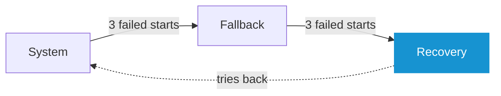

# Reference

What Arch OS writes to a disk, and why. The module format is described in **[➜ Runtime](../runtime/README.md)**.

## Start

The ISO boots into the Installer. A second console (**Ctrl+Alt+F2**) opens either module with `arch-os installer` or `arch-os recovery`. The ISO is a hybrid image, so any USB writer works. **[➜ Arch Wiki](https://wiki.archlinux.org/title/USB_flash_installation_medium)**

### Answers

Every answer except the passwords is saved to `installer.conf` as soon as it is given. An interrupted run resumes with them.

| Use | How |
| --- | --- |
| Same answers on another machine | Copy `installer.conf` from `/var/log/arch-os/` next to the Installer |
| Unattended | Run `arch-os installer --unattended` with `installer.conf` next to it and `ARCH_OS_PASSWORD` in the environment. **[➜ Runtime](../runtime/README.md#unattended)** |

### Commands

Every command that changes the system is shown and recorded in three places.

| Place | Form |
| --- | --- |
| **tab** | A box named after the step, above the command's output |
| `installer.log` | One line per command |
| `installer.sh` | A script of all commands |

`installer.sh` lies next to the Installer and in `/var/log/arch-os/` of the new system. Like the answers and the log, only root can read it. On the same machine the script installs the same system again: partitions, packages, files, accounts and services.

1. Copy `/var/log/arch-os/installer.sh` to another drive with `sudo`, since the script erases the disk it lies on
2. Boot the ISO, connect to the internet and open a shell with **Ctrl+Alt+F2**
3. Run `bash installer.sh`

The script has four parts.

| Part | Does |
| --- | --- |
| Head | Stops outside a live system. Stops where the disk's name points at another disk, compared by model, serial and size. Loads the console keyboard |
| Passwords | Asks as the Installer does, or reads `ARCH_OS_PASSWORD` and `ARCH_OS_DISK_PASSWORD` |
| Confirmation | Names the disk and opens on **No** |
| Commands | Runs the commands of each task that succeeded, under the task's title. A failed command stops the script |

Two things differ from the original run.

| Differs | What |
| --- | --- |
| New on each run | Package versions, the ranked mirrors, the machine ID and keys such as those of Secure Boot and SSH |
| Not in the script | Wi-Fi networks, which would carry their passphrase. Checks, retries and the clean-up of an earlier attempt |

## Disk

Arch OS takes a whole disk on a UEFI machine and partitions it with GPT. It is the only system on that disk. The disk needs at least 16 GiB, or 32 GiB with GNOME. The size is checked before anything is written.

### Partitions

| Partition | Size | Type | Label | Mounted |
| --- | --- | --- | --- | --- |
| 1 | 1 GiB | EFI system (`ef00`) | `BOOT` | `/boot`, `fmask=0077,dmask=0077` |
| 2 | The rest | Linux x86-64 root (`8304`) | `BTRFS` | `/` |
| 3 | 1 GiB, twice the image | Linux (`8300`) | None | Never. **[➜ Recovery Partition](#recovery-partition)** |

- The root partition type follows the **[Installation guide](https://wiki.archlinux.org/title/Installation_guide#Example_layouts)**, so systemd's tools find the partition
- Partition 3 exists only with **Recovery**. It lies at the end of the disk, so root stays partition 2

With **Encryption**, partition 2 is a LUKS2 container opened as `cryptroot`. Its password is the account password or a separate one. **[➜ Accounts](#accounts)**

| LUKS2 header flag | Effect |
| --- | --- |
| `--allow-discards` | TRIM passes through, so `fstrim.timer` needs no kernel parameter. This reveals which blocks are free, not their content. **[➜ Arch Wiki](https://wiki.archlinux.org/title/Dm-crypt/Specialties#Discard/TRIM_support_for_solid_state_drives_(SSD))** |
| `--perf-no_read_workqueue`, `--perf-no_write_workqueue` | Set on an SSD only. Requests reach the disk directly instead of waiting in a queue. **[➜ Arch Wiki](https://wiki.archlinux.org/title/Dm-crypt/Specialties#Disable_workqueue_for_increased_solid_state_drive_(SSD)_performance)** |

**Note:** _`--persistent` stores the flags in the header, so they apply on every unlock._

### Btrfs Subvolumes

| Subvolume | Mounted | Why separate |
| --- | --- | --- |
| `@` | `/` | The system. A rollback replaces it |
| `@home` | `/home` | Personal files. A rollback leaves them untouched |
| `@snapshots` | `/.snapshots` | The snapshots |
| `@log` | `/var/log` | Logs that show why a rollback was needed |
| `@cache` | `/var/cache` | The package cache is large and not needed in a snapshot |
| `@tmp` | `/var/tmp` | Scratch space, set to `chmod 1777` before systemd-tmpfiles runs |

- A snapshot of `@` excludes nested subvolumes, so a rollback keeps all six
- A subvolume created inside `@` later, such as a container image, moves to the new `@` on a rollback
- All are mounted with `noatime,compress=zstd:1`, as on Fedora. On an older CPU, level 1 costs far less per write than level 3 at almost the same ratio. **[➜ Arch Wiki](https://wiki.archlinux.org/title/Btrfs#Compression)**
- The layout is defined once in `lib.sh`. The Installer creates every subvolume. The Recovery opens only a disk that has all of them and leaves any other disk untouched

## Boot Chain

systemd-boot starts the system, its fallback and the Recovery. With **Secure Boot**, each entry starts a unified kernel image (UKI) signed with the machine's own keys.

| Part | How | Why |
| --- | --- | --- |
| Loader | `bootctl install` runs from the live system. Its firmware entry comes first in the boot order | In a chroot, `bootctl` writes no working firmware entry |
| UKIs | `/boot/EFI/arch-os/` | In `EFI/Linux` the loader would list each image twice |
| Menu | Hidden. Holding **Space** shows it | Some firmware passes the key too late, so the Recovery is also in the firmware boot menu |
| Order | `sort-key arch` and `arch-fallback` | The system comes first, the fallback second. The Recovery sorts by its `os-release` ID |
| Command line | `kernel_args` in the `bootloader` task, kept in `/etc/kernel/cmdline` | Images and entries share one source. The Recovery rebuilds lost entries from it |
| Editor | Off | An editable command line is a root shell without a password. **[➜ Arch Wiki](https://wiki.archlinux.org/title/Systemd-boot#Loader_configuration)** |

**Note:** _Firmware entries of earlier systems on the disk are removed with its partitions. Entries of other disks stay._

### Fallback

Each entry gets three tries. After three failed starts the loader moves on to the next entry. This needs no key, USB stick or network. The fallback image includes every kernel module. **[➜ Automatic Boot Assessment](https://systemd.io/AUTOMATIC_BOOT_ASSESSMENT/)**



A start is good once `boot-complete.target` is reached.

| Start | Counts as |
| --- | --- |
| Disk mounted and, with GNOME, the login screen or a session up | Good |
| To the console, such as with `multi-user.target` as default | Good. It waits for no session |
| With GNOME, no session within 5 minutes | Failed. `arch-os-session-up.service` waits that long |
| Interrupted, such as a power-off at the password prompt | Failed |
| Kernel panic | Failed. `panic=10` restarts the machine, so a system that panics on every start reaches the Recovery |
| Emergency mode, in the system or its initramfs | Failed. The machine restarts after 10 s. Root has no password, so nobody could use the emergency shell |

The loader counts in the entry's file name.

- Each start takes one try off the name: `main+3.conf` becomes `main+2-1.conf`. An entry without tries, `main+0-3.conf`, sorts last
- After a good start, `systemd-bless-boot` marks the entry as good and `arch-os-boot-tries.service` restores the tries of both entries
- `loader.conf` sets no `default`, since a default entry starts however often it failed. Installer and Recovery also clear a default left in the firmware

### Kernel Parameters

| Parameter | Why |
| --- | --- |
| `rd.luks.name=…=cryptroot` | Opens the disk in `sd-encrypt` |
| `rootflags=subvol=@ rootfstype=btrfs` | Selects the root subvolume |
| `zswap.enabled=0` | zswap conflicts with zram |
| `panic=10` | A panic restarts the machine and counts as a failed start |
| `quiet loglevel=3 …` | **[Silent boot](https://wiki.archlinux.org/title/Silent_boot)** |
| `vt.global_cursor_default=0` | Hides the console cursor. `/etc/issue.d/cursor.issue` restores it at each login |
| `splash plymouth.ignore-serial-consoles` | Set with the boot splash. Every VM has a serial console, which would switch Plymouth to text mode, password prompt included |
| `plymouth.use-simpledrm=0` | Set with encryption. The password prompt waits for the graphics driver instead of appearing twice. **[➜ Arch Wiki](https://wiki.archlinux.org/title/Plymouth#Using_SimpleDRM)** |
| `plymouth.splash-delay=3` | Set with encryption. Splash and password prompt appear together. **[➜ Arch Wiki](https://wiki.archlinux.org/title/Plymouth#Show_delay)** |

**Note:** _`RebootWatchdogSec=off` in `/etc/systemd/system.conf.d/10-arch-os.conf` belongs to the silent boot. A watchdog armed for the reboot prints `watchdog did not stop!` over the splash._

### Initramfs

```
base systemd keyboard autodetect microcode modconf kms sd-vconsole block [sd-encrypt] filesystems
```

| Hook | Why |
| --- | --- |
| `keyboard` before `autodetect` | Includes every keyboard driver, not only the one present during the installation |
| `microcode` | `intel-ucode` or `amd-ucode`, chosen from `/proc/cpuinfo`. Left out in a virtual machine, which gets its microcode from the host |
| `kms` | Plymouth needs a driver to draw on, so the open graphics drivers are included |
| No `fsck` | `fsck.btrfs` does nothing at boot |

- The hooks are set in `/etc/mkinitcpio.conf.d/10-arch-os.conf`. `20-` extends them for the boot splash, `30-` and `31-` for NVIDIA
- With NVIDIA as the only card, `31-` removes `kms`. Otherwise nouveau would load next to NVIDIA's modules. **[➜ Arch Wiki](https://wiki.archlinux.org/title/NVIDIA#Early_loading)**
- mkinitcpio's pacman hook rebuilds the image whenever an NVIDIA module changes

### Secure Boot

Offered only with disk encryption. Without encryption the disk is readable anyway. Only a UKI signs kernel, initramfs and command line as one file.

The Installer sets it up in three steps.

| When | What | Why |
| --- | --- | --- |
| First | Creates the keys and signs systemd-boot and the boot images, before any snapshot exists | The keys in `/var/lib/sbctl` are part of `@`. A snapshot without them could sign nothing it rebuilds after a rollback. The Recovery also carries the keys across a rollback |
| Last | Signs the Recovery, requires a clean `sbctl verify` and enrolls the keys | Once keys are enrolled, the firmware refuses anything unsigned |
| Afterwards | sbctl's hooks | New boot images are signed as they are built. Updates sign systemd-boot and the Recovery again |

- sbctl's mkinitcpio hook signs each boot image. `sbctl list-files` does not list them, since `sbctl sign -s` records no file that is already signed
- The kernel the UKIs are built from lies in `/var/lib/arch-os/`, on the encrypted root. On the EFI partition anyone could swap it before the next rebuild signs it. **[➜ Arch Wiki](https://wiki.archlinux.org/title/Unified_kernel_image#.preset_file)**

Keys enroll only in **setup mode**, which is not the same as "Secure Boot disabled".

| Option | Keeps |
| --- | --- |
| `-m` | Microsoft's certificates |
| `-f` | The firmware's own certificates, which firmware signed by its maker needs |

Where sbctl refuses `-f`, the Installer enrolls with `-m` alone. Keys that did not enroll are a warning on the last page. The machine still boots.

#### Turning It On

After the first reboot, with **Secure Boot** among the answers:

| `sbctl status` shows | Action |
| --- | --- |
| `✓` | Restart and turn Secure Boot on in the firmware |
| `✗` | Clear the keys in the firmware, which enters setup mode. Run `sudo sbctl enroll-keys -m -f`, or with `-m` alone where that fails. Restart and turn Secure Boot on |

#### Firmware Updates

fwupd's updater is signed as `fwupdx64.efi.signed`. `DisableShimForSecureBoot` lets fwupd start it without shim, which Arch does not ship. **[➜ fwupd](https://github.com/fwupd/fwupd/blob/main/plugins/uefi-capsule/README.md)**

For fwupd installed later:

```
sudo sbctl sign -s -o /usr/lib/fwupd/efi/fwupdx64.efi.signed /usr/lib/fwupd/efi/fwupdx64.efi
sudo fwupdtool modify-config uefi_capsule DisableShimForSecureBoot true
```

## System

Every machine gets the same base.

| Part | Choice | Why |
| --- | --- | --- |
| Kernel | `linux-zen` everywhere | One kernel means one set of known problems. It is tuned for responsiveness under load |
| Swap | zram | **[➜ Arch Wiki](https://wiki.archlinux.org/title/Zram)** |
| Disk health | `smartd`, with Housekeeping | A disk at risk shows on every terminal and as a critical notification in every session, not only in the journal. **[➜ Arch Wiki](https://wiki.archlinux.org/title/S.M.A.R.T.#Notifying_potential_problems)** |
| Crash records | `systemd-pstore` | Moves crash records from the small firmware memory to `/var/lib/systemd/pstore`. ISO and Recovery leave them in place. **[➜ systemd-pstore](https://www.freedesktop.org/software/systemd/man/latest/systemd-pstore.service.html)** |

### Tuning

These settings change behavior and install nothing. **[➜ Arch Wiki](https://wiki.archlinux.org/title/Sysctl)**

| Setting | Why |
| --- | --- |
| `vm.dirty_bytes=256M`, `_background_bytes=64M` | The default ratio writes gigabytes in one burst |
| `vm.vfs_cache_pressure=50` | Directory entries are cheap to keep and costly to look up again |
| `transparent_hugepage/defrag=defer+madvise` | Huge pages are available at once and defragmented in the background |
| `DefaultTimeoutStopSec=15s` for session services | With the default, a hung service delays logout by 90 s. System services keep the default, since a database stopped early loses data |
| `SystemMaxUse=200M` | Caps the journal |
| `bfq` on spinning disks | Keeps the system responsive while the disk seeks. Other disks keep the kernel default. **[➜ Arch Wiki](https://wiki.archlinux.org/title/Improving_performance#Changing_I/O_scheduler)** |
| `strict_limit=1`, `max_ratio=10` for USB drives | A copy finishes on the drive, not in memory, so ejecting does not hang. **[➜ Kernel](https://docs.kernel.org/admin-guide/abi-testing.html#abi-sys-class-bdi-bdi-strict-limit)** |
| `tcp_congestion_control=bbr`, `default_qdisc=fq` | Wi-Fi and long links lose packets without congestion, which `cubic` misreads |
| `tcp_mtu_probing=1` | Finds the smaller packet size of PPPoE or a tunnel when a router drops the ICMP message that reports it |
| `MAKEFLAGS` with one job per core, no debug package | AUR builds use every core. `-march=native` is not set, since its binaries fail on other hardware |

### Packages

The base is enough for a usable system and small enough to need no upkeep. Everything else follows the answers: the task that enables a service installs its package.

| Package | Why |
| --- | --- |
| `base`, `linux-zen`, `mkinitcpio`, `sudo`, `zram-generator`, `networkmanager`, `btrfs-progs`, `snapper` | The system itself |
| `dosfstools` | systemd checks the EFI partition at every boot. Boot counting writes there, and FAT has no journal |
| `pacman-contrib` | `paccache.timer` keeps three versions of each installed package. pacman alone keeps every version it downloads |
| Chosen editor, `man-db`, `man-pages`, `openssh` | Not part of `base` |
| `linux-firmware`, `sof-firmware`, `wireless-regdb` | `sof-firmware` drives the sound of many laptops. All three are left out in a VM without a passed-through card, since its drivers are in the kernel |

A Wi-Fi network joined in the Installer becomes a NetworkManager connection, so the first boot is online. An 802.1X network has to be joined again.

Graphics drivers come with GNOME. Each card is detected in sysfs. Mesa, `mesa-utils` and `vulkan-tools` are always installed. **[➜ Arch Wiki](https://wiki.archlinux.org/title/Hardware_video_acceleration)**

| Card | Packages |
| --- | --- |
| Intel | `vulkan-intel`, with `intel-media-driver` from Broadwell on and `libva-intel-driver` before |
| AMD | `vulkan-radeon`, `opencl-mesa` |
| NVIDIA from Turing on (`0x1e00`) | `nvidia-open-dkms` with headers, `nvidia-utils`, `nvidia-settings`, `opencl-nvidia`, `libva-nvidia-driver`, and `nvidia-prime` beside another card. **[➜ Arch Wiki](https://wiki.archlinux.org/title/NVIDIA)** |
| NVIDIA before Turing | `vulkan-nouveau`. Arch has no NVIDIA driver for these cards |
| VM adapter | Mesa and the guest tools of the hypervisor |

**Note:** _With 32-bit support, each driver gets its `lib32-` counterpart._

**Note:** _A step the system works without may fail without stopping the run, such as the browser, the desktop extras or the VM guest tools. The last page lists it._

### AUR Builds

`paru`, the boot splash theme and the System Manager come from the AUR. Each may fail without stopping the run. The AUR can be down for days, and nothing else depends on them.

| Limit | Value | Why |
| --- | --- | --- |
| Attempts | 3 | A retry helps a failed download, not a stuck build |
| Timeout | 45 min | A build that takes longer hangs |
| Compile jobs | 1 per GiB of memory, at most 1 per core | More jobs run a live system out of memory |

- `sudo` runs `pacman` without a password during the build, and nothing else. The rule expires by itself (`NOTAFTER`) if the run stops halfway
- The build runs in its own environment, without the passwords. cargo downloads stay in the build directory
- `paru` is built from source, since a `-bin` package breaks whenever Arch bumps `libalpm`

### Text Editor

The chosen editor gets a small configuration in the account's home and in root's, never in `/etc`. It uses built-in features only, so nothing but the package needs updates.

| Editor | File | Beyond its defaults |
| --- | --- | --- |
| `nano` | `~/.config/nano/nanorc` | Line numbers, minibar, mouse, auto-indent, tabs of 4, soft wrap, `nano-syntax-highlighting` |
| `vim` | `~/.vim/vimrc` | `habamax`, `defaults.vim`, line numbers, 4 spaces, smart-case search |
| `neovim` | `~/.config/nvim/init.lua` | Line numbers, 4 spaces, smart-case search, persistent undo |
| `micro` | `~/.config/micro/settings.json` | `atom-dark`, 4 spaces, changes in the gutter, cursor and undo kept |
| `helix` | `~/.config/helix/config.toml` | `nord`, mode colors, bar cursor, tabs, indent guides, soft wrap |

**Note:** _Vim's file is `~/.vim/vimrc`, since Vim reads `~/.config/vim/` only with `XDG_CONFIG_HOME` set._

## Accounts

The Installer creates one account in `wheel`, with `sudo`. Root keeps Arch's locked password. `sudo` grants the same rights, and the **[Recovery](#recovery)** opens a system that no longer starts. A name that the system or a package claims, such as `docker` or `gdm`, is refused before anything is written.

| Answers | Disk | Login |
| --- | --- | --- |
| One password | Unlocked with the account password | Automatic with GNOME. `pam_gdm` passes the disk password to the keyring, which works only if it matches the account password |
| Separate disk password | Unlocked with its own password | Login screen that lists every account. Meant for shared machines |
| No encryption | Open | Login screen |

More accounts are added in **Settings ➜ System ➜ Users ➜ Add User**. **Parental Controls** there restricts an account through Flatpak. On the console, `sudo useradd -m <name>` and `sudo passwd <name>` do the same. **[➜ Arch Wiki](https://wiki.archlinux.org/title/GNOME/Keyring#PAM_step)**

**Note:** _On a shared machine with one password, turn automatic login off in **Settings ➜ System ➜ Users**._

### Keyring

GNOME asks for the keyring password after login whenever it differs from the login password. Four changes cause that.

| After | Keyring password to set |
| --- | --- |
| Changing the disk password, with automatic login | New disk password |
| Changing the account password | New account password |
| Turning automatic login on, with a separate disk password | Disk password |
| Turning automatic login off, with two passwords | Account password |

- The keyring password is changed in **Passwords and Keys** (`sudo pacman -S seahorse`) under **Login ➜ Change Password**
- The disk password is changed with `sudo cryptsetup luksChangeKey /dev/<partition>`, on the partition `lsblk -f` lists as `crypto_LUKS`

## GNOME

Packages are filtered before the installation, so what **Slim desktop** leaves out is never downloaded.

| Part | What |
| --- | --- |
| App store | GNOME Software installs Flatpaks and, with `fwupd` from **Desktop extras**, firmware. There is no PackageKit, so only pacman changes the system. **[➜ Arch Wiki](https://wiki.archlinux.org/title/Pacman/Tips_and_tricks#Graphical)** |
| Bazaar | Replaces GNOME Software when Flatpak is chosen. `gnome-firmware` comes with it, since Bazaar installs Flatpaks only. **[➜ Bazaar](https://apps.gnome.org/Bazaar/)** |
| Browser | Default for web links and, with **Desktop extras**, pinned to the dock. Installed in the system language. **[➜ Arch Wiki](https://wiki.archlinux.org/title/Firefox)** |
| `.local` names | `nss-mdns` comes before the resolver in `/etc/nsswitch.conf`, so printers, shares and machines resolve by name. **[➜ Arch Wiki](https://wiki.archlinux.org/title/Avahi#Hostname_resolution)** |
| GNOME Boxes | Works once installed: libvirt session, KVM open to every account, disks in the home folder. A QEMU guest gets `phodav` for shared folders. **[➜ GNOME Boxes](https://apps.gnome.org/Boxes/)** |
| Extensions | Installed from **[extensions.gnome.org](https://extensions.gnome.org)** through `gnome-browser-connector`, with **Desktop extras**. The **Extensions** app manages them |
| File sharing | Shares the home folder and a public folder that guests read and the owner writes. Both are announced under the hostname (`mdns name = mdns`) |
| Firmware | `fwupd-refresh.timer` keeps the catalog current wherever `fwupd` is installed, with **Desktop extras** or GNOME Firmware. **[➜ Arch Wiki](https://wiki.archlinux.org/title/Fwupd)** |

The browser gets what its language and media support need.

| Browser | Extras |
| --- | --- |
| Firefox | `firefox-i18n-<lang>`, `hunspell-<lang>` |
| GNOME Web | `hunspell-<lang>`, codecs, GPU decoding |
| Vivaldi | Codecs |

### Out of Memory

`systemd-oomd` stops one app before GNOME freezes. GNOME runs each app in its own scope, so nothing else is hit. **[➜ Arch Wiki](https://wiki.archlinux.org/title/Improving_performance#Improving_system_responsiveness_under_low-memory_conditions)**

| Unit | Setting | Acts when |
| --- | --- | --- |
| `-.slice` | `ManagedOOMSwap=kill` | Memory and swap are both over 90 %. The unit using the most swap is killed |
| `user@.service` | `ManagedOOMMemoryPressure=kill`, limit `50%` | The session stalls on memory half the time for 30 s. This is Fedora's limit, below systemd's 60 % |

### Defaults

Every account starts with the same defaults and can change them.

| What | Where |
| --- | --- |
| Keyboard, dock, theme, keys, terminal font | dconf keyfiles in `/etc/dconf/db/local.d/`. **[➜ GNOME](https://help.gnome.org/admin/system-admin-guide/stable/dconf-custom-defaults.html)** |
| Apps installed as a dependency | Hidden by `Hidden=true` entries in `/usr/local/share/applications/` |
| `~/.local/bin` in `PATH` | `/etc/environment.d/60-arch-os.conf` |
| Git passwords in the keyring | `credential.helper` in `/etc/gitconfig` |

## Firewall

`firewalld` filters incoming connections. NetworkManager assigns each connection its zone, and libvirt and podman open their own ports. **[➜ Arch Wiki](https://wiki.archlinux.org/title/Firewalld)**

| Zone | Where | Allows |
| --- | --- | --- |
| `public` | Every network not marked | `dhcpv6-client`, `mdns` with GNOME, `ssh` with the SSH server |
| `home` | Networks marked as trusted | firewalld's default set. With GNOME also `32768-60999/tcp`, `rdp` and `ssdp`. With file sharing also `samba` and `ws-discovery-host` |

No machine can tell a café's Wi-Fi from a home network, so a network is trusted only once it is marked:

```
nmcli connection modify <name> connection.zone home
```

| Service | Zone | Why |
| --- | --- | --- |
| `mdns` | `public` | mDNS replies arrive as multicast, which connection tracking cannot match. They reveal nothing beyond Avahi's announcements |
| `ssh` | `public` | Reachable from any network, so it takes keys only |
| `32768-60999/tcp` | `home` | GNOME's file and media sharing listen on a random port from `ip_local_port_range` and ask for no password by default |
| `rdp`, `ssdp` | `home` | GNOME's remote desktop, and players that look for its media sharing. On a café's Wi-Fi anyone could try them |
| `samba`, `ws-discovery-host` | `home` | On a café's Wi-Fi anyone could try the account password against a share |

- Docker bypasses firewalld. With the firewall, its published ports therefore bind to `127.0.0.1`, and `-p 0.0.0.0:8080:80` publishes one to the network. **[➜ Docker](https://docs.docker.com/engine/network/packet-filtering-firewalls/)**
- The SSH server takes keys only, set in `/etc/ssh/sshd_config.d/10-arch-os.conf`. The Installer asks for the account's key and writes it to `~/.ssh/authorized_keys`. It accepts a public key or a URL such as `https://github.com/<user>.keys`

## Offline

An installed system needs no internet until the next update.

- Mirror ranking and keyring refresh are skipped while archlinux.org is unreachable, so `systemctl --failed` stays empty
- Each of the two has an `online.conf` drop-in that checks with `ExecCondition=` and logs a skip to the journal
- The Recovery repairs from what the system holds, without downloads

**Note:** _After months offline, update the keyring first: `sudo pacman -Sy archlinux-keyring && sudo pacman -Su`. **[➜ Arch Wiki](https://wiki.archlinux.org/title/Pacman/Package_signing#Upgrade_system_regularly)**_

## Snapshots

Snapper takes snapshots of `@` on two occasions and at no other time.

| Snapshot | When | Kept |
| --- | --- | --- |
| `pre` and `post` | Before and after every package transaction, through `snap-pac` | The newest 10 |
| `last good boot` | After every **[good start](#fallback)**, through `arch-os-boot-snapshot.service` | One. The next good start replaces it |

- The boot snapshot also holds changes made by hand, such as an edited file in `/etc`, and shows a system that started
- It has no cleanup algorithm, so the limit of the package snapshots leaves it alone

| Setting | Value | Why |
| --- | --- | --- |
| Timeline | Off | Between transactions mostly data changes. A timeline keeps every version of disk images and databases. openSUSE's root configuration avoids it too |
| `NUMBER_LIMIT` | 10 | Snapper's defaults filled 70 GiB for a 35 GiB system |
| `ALLOW_GROUPS` | None | snapperd runs as root, so an allowed group could delete every snapshot without a password. `sudo snapper list` lists them |
| Cleanup | `snapper-cleanup.timer` | Enforces the limit |

### Rollback

A rollback runs from the Recovery only. The boot images lie on the EFI partition and belong to no snapshot, so an older snapshot alone would start a kernel without its modules.

1. The Recovery puts the snapshot in place of `@`
2. It rebuilds the boot files from the kernel image that Arch keeps beside the modules in `/usr/lib/modules/`, which is part of the snapshot

## Recovery

The Recovery repairs a system that no longer starts. It runs from its own partition or from the ISO.

| From | How |
| --- | --- |
| Partition | **Arch OS Recovery** in the boot menu, in the firmware boot menu (**F12** on most machines), or **Recovery** in the app grid. Works with Secure Boot on |
| ISO | `arch-os recovery` on another console (**Ctrl+Alt+F2**), with Secure Boot off |

From the ISO it asks for keyboard and disk. On its partition it asks for neither. Everything else is read from the disk. **[➜ Recovery](../recovery/README.md#answers)**

- Before it writes to the EFI partition, it checks it with `fsck.fat`, as the system does at boot
- It repairs what the Installer of its release series creates, and needs no network for that. **Connect to Wi-Fi** on the dashboard is there for an update or for a download in the shell
- A rollback builds the new `@` before it touches the old one and keeps the old one as a snapshot, so it can be undone. The next run completes an interrupted rollback
- `systemctl reboot --boot-loader-entry=arch-os-recovery.efi` starts it once. **Recovery** in the app grid does the same after a confirmation that opens on **Cancel**

**Note:** _Without disk encryption, anyone at the machine can open the system from the Recovery, as from any USB stick._

### Recovery Partition

The partition holds the Recovery of the release that installed the system. The ISO carries it, and the Installer writes it to the disk. It is built from Arch's `baseline` profile: kernel, `base`, `btrfs-progs`, `arch-install-scripts`, Plymouth, the Recovery, and `iwd` with Wi-Fi firmware.

| File | Target | Content |
| --- | --- | --- |
| `recovery.efi` | `/boot/EFI/Linux/arch-os-recovery.efi` | The UKI. Its firmware entry stays outside the boot order, since Insyde firmware moves any entry there to the front for good |
| `recovery.img` | Partition 3, byte for byte | A read-only erofs with its signature. The system never mounts it, and the file manager does not show it |

It boots in six steps.

1. The loader starts the image. Under Secure Boot it is signed with the machine's keys
2. The initramfs finds the partition by a UUID unique to each build
3. The initramfs verifies the root against a certificate whose key was deleted after the build. The certificate is valid from 1970 to 9999, so a dead clock battery does not break it
4. The root is copied to memory, which frees the disk
5. Plymouth draws on the firmware framebuffer (`nomodeset`). The Recovery runs on tty1 and sets its clock by network time, which HTTPS needs after a dead clock battery
6. The Recovery reads `EFI/arch-os-recovery/` on the EFI partition it started from, restores the tries of the system's entries and opens in the Installer's language and keyboard

It runs as a kiosk.

- tty1 belongs to the Recovery. No console has a login, a serial one included, and root is locked
- **Start over** or a crash restarts it with every answer kept (`RestartMode=direct`)

**Note:** _The EFI partition is unsigned, so what the Recovery reads there is checked like any answer from a file._

#### Update

**Update the Recovery** on the dashboard checks the GitHub releases and installs after a confirmation that opens on **No**.

| Rule | Detail |
| --- | --- |
| Within its series only | 2.1.0 updates to 2.4.1, never to 3.0.0, whose Recovery may not repair this layout |
| From the ISO too | The ISO updates the disk's Recovery where that is older or no longer starts. This is the way back after an interrupted update |
| Checked first | Download, checksum and size are checked before the partition is touched |
| Signed | An encrypted system is opened. Where it has `sbctl`, its keys sign the new image |
| Safe against a power cut | The partition is written and read back, then the boot image is replaced. After a power cut in between, the system starts as before |
| Same partition | It keeps its PARTUUID and stays hidden from the file manager |

**Note:** _Releases before 2.1 are not supported. A 2.0 Recovery with Secure Boot and disk encryption needs 4 GiB of memory to update itself. With less memory, the ISO updates it._
