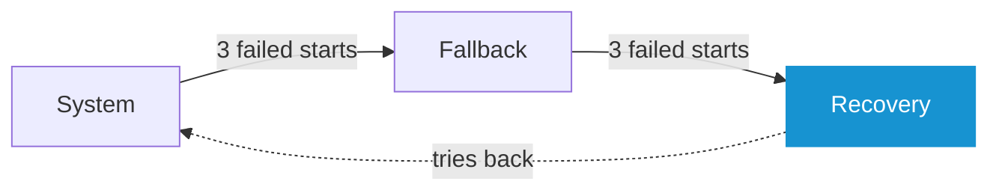

# Reference

What Arch OS puts on a disk and why. Module format: **[➜ Runtime](../runtime/README.md)**

## Start

The ISO starts the Installer. `arch-os installer` or `arch-os recovery` on another console (**Ctrl+Alt+F2**) opens either. The ISO is hybrid and works with any USB writer. **[➜ Arch Wiki](https://wiki.archlinux.org/title/USB_flash_installation_medium)**

### Answers

Every answer except the passwords lands in `installer.conf` at once, so an interrupted run resumes.

| Way | How |
| --- | --- |
| Share | **Share the configuration** on the last page uploads the answers to **[paste.rs](https://paste.rs)**. The **Shared configuration** profile loads them and asks only for disk, passwords and, with the SSH server, the key |
| Copy | `installer.conf` beside the Installer on another machine |
| Unattended | `arch-os installer --unattended` with `installer.conf` beside it and `ARCH_OS_PASSWORD` in the environment. **[➜ Runtime](../runtime/README.md#unattended)** |

**Note:** _A shared configuration holds hostname, username and language, readable by anyone with the link. The import skips disk, kernel parameters and SSH key: the disk belongs to one machine, foreign kernel parameters can open a root shell at boot, and a foreign key a remote login._

## Disk

UEFI, GPT, whole disk: Arch OS is the only system on it. At least 16 GiB, 32 GiB with GNOME, checked before anything is written.

### Partitions

| Partition | Size | Type | Label | Mounted |
| --- | --- | --- | --- | --- |
| 1 | 1 GiB | EFI system (`ef00`) | `BOOT` | `/boot`, `fmask=0077,dmask=0077` |
| 2 | the rest | Linux x86-64 root (`8304`) | `BTRFS` | `/` |
| 3 | 1 GiB, twice the image | Linux (`8300`) | - | never, **[➜ Recovery Partition](#recovery-partition)** |

- Root partition type from the **[Installation guide](https://wiki.archlinux.org/title/Installation_guide#Example_layouts)**, found by systemd's tools
- Partition 3 only with **Recovery**, at the end, so root stays partition 2
- **Encryption:** LUKS2 on partition 2 as `cryptroot`, with the account password or its own. **[➜ Accounts](#accounts)**
- **TRIM:** `--allow-discards --persistent` in the LUKS2 header, so `fstrim.timer` needs no kernel parameter. Reveals which blocks are free, not their content. **[➜ Arch Wiki](https://wiki.archlinux.org/title/Dm-crypt/Specialties#Discard/TRIM_support_for_solid_state_drives_(SSD))**
- **Workqueues:** off on an SSD (`--perf-no_read_workqueue --perf-no_write_workqueue`, also in the header), so requests reach the disk directly. **[➜ Arch Wiki](https://wiki.archlinux.org/title/Dm-crypt/Specialties#Disable_workqueue_for_increased_solid_state_drive_(SSD)_performance)**

### Btrfs Subvolumes

| Subvolume | Mounted | Why separate |
| --- | --- | --- |
| `@` | `/` | System, replaced by a rollback |
| `@home` | `/home` | Personal files, untouched by a rollback |
| `@snapshots` | `/.snapshots` | Snapshots |
| `@log` | `/var/log` | Logs that show why a rollback was needed |
| `@cache` | `/var/cache` | Package cache, large and not needed in a snapshot |
| `@tmp` | `/var/tmp` | Scratch space, `chmod 1777` before systemd-tmpfiles runs |

- A snapshot of `@` excludes nested subvolumes, so a rollback keeps all six. One created inside `@` later, such as a container image, moves to the new `@`
- `defaults,noatime,compress=zstd:1`, as on Fedora. Level 1 costs an older CPU far less per write than 3, at almost the same ratio. **[➜ Arch Wiki](https://wiki.archlinux.org/title/Btrfs#Compression)**
- Defined once in `lib.sh`. The Installer creates every subvolume, the Recovery opens only a disk with all of them and leaves others untouched

## Boot Chain

systemd-boot starts the system, its fallback and the Recovery. With **Secure Boot** each entry starts a unified kernel image (UKI) signed with the machine's own keys.

| Part | How | Why |
| --- | --- | --- |
| Loader | `bootctl install` from the live system, its firmware entry first in the boot order | In a chroot `bootctl` writes no working firmware entry |
| UKIs | `/boot/EFI/arch-os/` | In `EFI/Linux` the loader lists each twice |
| Menu | Hidden, shown while **Space** is held | Some firmware passes the key too late, so the Recovery is also in the firmware boot menu |
| Order | `sort-key arch` and `arch-fallback` | System first, fallback second. The Recovery sorts by its `os-release` ID |
| Command line | `kernel_args` in the `bootloader` task, kept in `/etc/kernel/cmdline` | One source for images and entries. The Recovery rebuilds lost entries from it |
| Editor | Off | An editable command line is a root shell without password. **[➜ Arch Wiki](https://wiki.archlinux.org/title/Systemd-boot#Loader_configuration)** |

**Note:** _Firmware entries of previous systems on the disk go with its partitions. Entries of other disks stay._

### Fallback

Each entry gets three tries, then the loader starts the next. The fallback includes every kernel module. No key, USB stick or network needed. **[➜ Automatic Boot Assessment](https://systemd.io/AUTOMATIC_BOOT_ASSESSMENT/)**



- A start takes a try off the entry name: `main+3.conf` becomes `main+2-1.conf`, `main+0-3.conf` sorts last
- A start counts as good once the disk is mounted and, with GNOME, the login screen or session is up (`boot-complete.target`). `systemd-bless-boot` marks the entry, `arch-os-boot-tries.service` restores the tries of both entries
- A start to the console, such as with `multi-user.target` as default, waits for no session
- No `default` in `loader.conf`: a default entry starts however often it failed. Installer and Recovery clear one left in the firmware
- An interrupted start counts as failed, such as a power-off at the password prompt
- `panic=10` restarts after a kernel panic, so a system that panics at every start reaches the Recovery
- Emergency mode restarts after 10 s, in the system and its initramfs: root has no password, so the emergency shell would wait for nobody
- With GNOME, `arch-os-session-up.service` waits up to 5 minutes for the session. Without one the start does not count

### Kernel Parameters

| Parameter | Why |
| --- | --- |
| `rd.luks.name=…=cryptroot` | Opens the disk in `sd-encrypt` |
| `rootflags=subvol=@ rootfstype=btrfs` | Root subvolume |
| `zswap.enabled=0` | Conflicts with zram |
| `panic=10` | A panic counts as a failed start |
| `quiet splash loglevel=3 …` | **[Silent boot](https://wiki.archlinux.org/title/Silent_boot)**. `vt.global_cursor_default=0` hides the cursor, `/etc/issue.d/cursor.issue` restores it at each login |
| `plymouth.ignore-serial-consoles` | Every VM has a serial console, which switches Plymouth to text mode, password prompt included |
| `plymouth.use-simpledrm=0` | With encryption: the password prompt waits for the graphics driver instead of appearing twice. **[➜ Arch Wiki](https://wiki.archlinux.org/title/Plymouth#Using_SimpleDRM)** |
| `plymouth.splash-delay=3` | With encryption: splash and password prompt appear together. **[➜ Arch Wiki](https://wiki.archlinux.org/title/Plymouth#Show_delay)** |

### Initramfs

```
base systemd keyboard autodetect microcode modconf kms sd-vconsole block [sd-encrypt] filesystems
```

| Hook | Why |
| --- | --- |
| `keyboard` before `autodetect` | Every keyboard driver, not only the one present during the installation |
| `microcode` | `intel-ucode` or `amd-ucode`, from `/proc/cpuinfo` |
| `kms` | Plymouth needs a driver to draw on, so the open graphics drivers go in. With NVIDIA as the only card, `31-` removes it, or nouveau would sit beside NVIDIA's modules. **[➜ Arch Wiki](https://wiki.archlinux.org/title/NVIDIA#Early_loading)** |
| No `fsck` | `fsck.btrfs` does nothing at boot |

**Note:** _Hooks in `/etc/mkinitcpio.conf.d/10-arch-os.conf`, extended by `20-` for the boot splash and `30-`, `31-` for NVIDIA. mkinitcpio's pacman hook rebuilds the image on every NVIDIA module change._

### Secure Boot

Only with disk encryption. Without it the disk is readable anyway, and only a UKI signs kernel, initramfs and command line as one.

| When | What | Why |
| --- | --- | --- |
| First | Keys, systemd-boot and boot images, before any snapshot | `/var/lib/sbctl` lives in `@`. After a rollback to a snapshot without the keys nothing rebuilt could be signed. The Recovery keeps them across a rollback |
| Last | Recovery signed, `sbctl verify` clean, keys enrolled | Enrolled keys refuse anything unsigned |
| After | sbctl's hooks | New images get signed, updates re-sign systemd-boot and the Recovery |

- sbctl's mkinitcpio hook signs each boot image as it is built. `sbctl list-files` omits them, since `sbctl sign -s` records no file already signed
- The kernel the UKIs are built from lies in `/var/lib/arch-os/`, on the encrypted root. On the EFI partition anyone could swap it before the next rebuild signs it. **[➜ Arch Wiki](https://wiki.archlinux.org/title/Unified_kernel_image#.preset_file)**
- fwupd's updater is signed as `fwupdx64.efi.signed`, and `DisableShimForSecureBoot` lets fwupd start it without shim, which Arch does not ship. For fwupd installed later: `sudo sbctl sign -s -o /usr/lib/fwupd/efi/fwupdx64.efi.signed /usr/lib/fwupd/efi/fwupdx64.efi` and `sudo fwupdtool modify-config uefi_capsule DisableShimForSecureBoot true`. **[➜ fwupd](https://github.com/fwupd/fwupd/blob/main/plugins/uefi-capsule/README.md)**
- Keys enroll only in **setup mode**, which differs from "Secure Boot disabled". `-m` keeps Microsoft's certificates, `-f` the firmware's own, which firmware signed by its maker needs. Where sbctl refuses `-f`, `-m` alone follows. A failure is logged, the machine still boots

#### Turning It On

After the first reboot, with **Secure Boot** among the answers:

| `sbctl status` shows | Action |
| --- | --- |
| `✓` | Restart, turn Secure Boot on in the firmware |
| `✗` | Clear the keys in the firmware (setup mode), run `sudo sbctl enroll-keys -m -f`, or `-m` alone where that fails, restart, turn Secure Boot on |

## System

Same base on every machine.

| Part | Choice | Why |
| --- | --- | --- |
| Kernel | `linux-zen` everywhere | One kernel, one set of known problems. Tuned for responsiveness under load |
| Swap | zram | **[➜ Arch Wiki](https://wiki.archlinux.org/title/Zram)** |
| Disk health | `smartd`, with Housekeeping | A disk at risk shows on every terminal and as a critical notification in every session, not only in the journal. **[➜ Arch Wiki](https://wiki.archlinux.org/title/S.M.A.R.T.#Notifying_potential_problems)** |
| Crash records | `systemd-pstore` | Moves crash records from the small firmware memory to `/var/lib/systemd/pstore`. ISO and Recovery leave them in place. **[➜ systemd-pstore](https://www.freedesktop.org/software/systemd/man/latest/systemd-pstore.service.html)** |

### Tuning

Part of **Core tweaks**. Changes behavior, installs nothing. **[➜ Arch Wiki](https://wiki.archlinux.org/title/Sysctl)**

| Setting | Why |
| --- | --- |
| `vm.dirty_bytes=256M`, `_background_bytes=64M` | The default ratio writes gigabytes in one burst |
| `vm.vfs_cache_pressure=50` | Directory entries are cheap to keep and costly to look up again |
| `transparent_hugepage/defrag=defer+madvise` | Huge pages at once, defragmented in the background |
| `DefaultTimeoutStopSec=15s` for session services | The default lets a hung service delay logout by 90 s. System services keep it, since a database stopped early loses data |
| `SystemMaxUse=200M` | Caps the journal |
| `bfq` on spinning disks | Keeps the system responsive while the disk seeks. Other disks keep the kernel default. **[➜ Arch Wiki](https://wiki.archlinux.org/title/Improving_performance#Changing_I/O_scheduler)** |
| `strict_limit=1`, `max_ratio=10` for USB drives | A copy finishes on the drive, not in memory, so ejecting does not hang. **[➜ Kernel](https://docs.kernel.org/admin-guide/abi-testing.html#abi-sys-class-bdi-bdi-strict-limit)** |
| `tcp_congestion_control=bbr`, `default_qdisc=fq` | Wi-Fi and long links lose packets without congestion, which `cubic` misreads |
| `tcp_mtu_probing=1` | Finds the smaller packet size of PPPoE or a tunnel when a router drops the ICMP message reporting it |
| `MAKEFLAGS` with one job per core, no debug package | AUR builds use every core. No `-march=native`: binaries would fail on other hardware |

### Packages

Enough for a usable system, few enough to need no upkeep. The rest follows the answers: the task that enables a service installs its package.

| Package | Why |
| --- | --- |
| `base`, `linux-zen`, `mkinitcpio`, `sudo`, `zram-generator`, `networkmanager`, `btrfs-progs`, `snapper` | The system itself |
| `dosfstools` | systemd checks the EFI partition at every boot. Boot counting writes there, and FAT has no journal |
| Chosen editor, `man-db`, `man-pages`, `openssh` | Not in `base` |
| `linux-firmware`, `sof-firmware`, `wireless-regdb` | Omitted in a VM without a passed-through card, whose drivers are in the kernel. `sof-firmware` is the sound of many laptops |

- A Wi-Fi network joined in the Installer becomes a NetworkManager connection, so the first boot is online. An 802.1X network needs joining again
- Graphics drivers with GNOME, detected per card in sysfs. Always Mesa, `vkd3d`, `mesa-utils` and `vulkan-tools`. **[➜ Arch Wiki](https://wiki.archlinux.org/title/Hardware_video_acceleration)**

| Card | Packages |
| --- | --- |
| Intel | `vulkan-intel`, `intel-media-driver` from Broadwell on, `libva-intel-driver` before |
| AMD | `vulkan-radeon`, `vulkan-mesa-layers`, `opencl-mesa` |
| NVIDIA from Turing on (`0x1e00`) | `nvidia-open-dkms` with headers, `nvidia-utils`, `nvidia-settings`, `opencl-nvidia`, `libva-nvidia-driver`, `nvidia-prime` beside another card. **[➜ Arch Wiki](https://wiki.archlinux.org/title/NVIDIA)** |
| NVIDIA before Turing | `vulkan-nouveau`. Arch has no NVIDIA driver for these |
| VM adapter | Mesa, plus the guest tools of the hypervisor |

**Note:** _With 32-bit support each driver gets its `lib32-` counterpart._

### AUR Builds

`paru`, the boot splash theme and the System Manager come from the AUR. Each may fail without stopping the run: the AUR can be down for days, and nothing else needs them.

| Limit | Value | Why |
| --- | --- | --- |
| Attempts | 3 | Retries downloads, not a stuck build |
| Timeout | 45 min | Past this it hangs |
| Compile jobs | 1 per GiB of memory, at most 1 per core | More runs a live system out of memory |

- Passwordless `sudo` for `pacman` only, only during the build. The rule expires by itself (`NOTAFTER`) if the run stops halfway
- The build runs in its own environment, without the passwords. cargo downloads stay in the build directory
- `paru` builds from source: a `-bin` package breaks whenever Arch bumps `libalpm`

### Text Editor

A small configuration in the account's home and root's, never in `/etc`. Built-in features only, nothing to update besides the package.

| Editor | File | Beyond its defaults |
| --- | --- | --- |
| `nano` | `~/.config/nano/nanorc` | Line numbers, minibar, mouse, auto-indent, tabs of 4, soft wrap, `nano-syntax-highlighting` |
| `vim` | `~/.vim/vimrc` | `habamax`, `defaults.vim`, line numbers, 4 spaces, smart-case search |
| `neovim` | `~/.config/nvim/init.lua` | Line numbers, 4 spaces, smart-case search, persistent undo |
| `micro` | `~/.config/micro/settings.json` | `atom-dark`, 4 spaces, changes in the gutter, cursor and undo kept |
| `helix` | `~/.config/helix/config.toml` | `nord`, mode colors, bar cursor, tabs, indent guides, soft wrap |

**Note:** _`~/.vim/vimrc`, since Vim reads `~/.config/vim/` only with `XDG_CONFIG_HOME` set._

## Accounts

One account in `wheel`, with `sudo`. Root keeps Arch's locked password: `sudo` grants the same rights, and the **[Recovery](#recovery)** opens a system that no longer starts. A name the system or a package claims, such as `docker` or `gdm`, is refused before anything is written.

| Answers | Disk | Login |
| --- | --- | --- |
| One password | Unlocked with the account password | Automatic with GNOME. `pam_gdm` passes the disk password to the keyring, which works only if it matches the account password |
| Separate disk password | Own password | Login screen listing every account. For shared machines |
| No encryption | Open | Login screen |

More accounts: **Settings ➜ System ➜ Users ➜ Add User**, with **Parental Controls** to restrict one through Flatpak, or `sudo useradd -m <name>` and `sudo passwd <name>`. **[➜ Arch Wiki](https://wiki.archlinux.org/title/GNOME/Keyring#PAM_step)**

**Note:** _On a shared machine with one password, turn automatic login off in **Settings ➜ System ➜ Users**._

### Keyring

A keyring password that differs from the login password is asked after login. Change it in **Passwords and Keys** (`sudo pacman -S seahorse`): **Login ➜ Change Password**.

| After | Keyring password |
| --- | --- |
| Changing the disk password, with automatic login | New disk password |
| Changing the account password | New account password |
| Turning automatic login on, with a separate disk password | Disk password |
| Turning automatic login off, with two passwords | Account password |

**Note:** _Change the disk password with `sudo cryptsetup luksChangeKey /dev/<partition>`, on the partition `lsblk -f` lists as `crypto_LUKS`._

## GNOME

Filtered before installing: what **Slim desktop** leaves out is never downloaded.

| Part | What |
| --- | --- |
| App store | GNOME Software installs Flatpaks and, with `fwupd` from **Desktop extras**, firmware. No PackageKit, so only pacman changes the system. **[➜ Arch Wiki](https://wiki.archlinux.org/title/Pacman/Tips_and_tricks#Graphical)** |
| Bazaar | Replaces it with Flatpak chosen, plus `gnome-firmware`, since Bazaar installs Flatpaks only. **[➜ Bazaar](https://apps.gnome.org/Bazaar/)** |
| Browser | In the system language: `firefox-i18n-<lang>` for Firefox, `hunspell-<lang>` for Firefox and GNOME Web, codecs for GNOME Web and Vivaldi. Default for web links, pinned to the dock with **Desktop extras**. **[➜ Arch Wiki](https://wiki.archlinux.org/title/Firefox)** |
| `.local` names | `nss-mdns` before the resolver in `/etc/nsswitch.conf`, so printers, shares and machines resolve by name. **[➜ Arch Wiki](https://wiki.archlinux.org/title/Avahi#Hostname_resolution)** |
| GNOME Boxes | Works once installed: libvirt session, KVM open to every account, disks in the home folder. A QEMU guest gets `phodav` for shared folders. **[➜ GNOME Boxes](https://apps.gnome.org/Boxes/)** |
| Extensions | From **[extensions.gnome.org](https://extensions.gnome.org)** through `gnome-browser-connector` with **Desktop extras**, managed in the **Extensions** app |
| File sharing | The home folder, and a public folder readable by guests and writable by the owner, announced under the hostname (`mdns name = mdns`) |
| Firmware | `fwupd-refresh.timer` keeps the catalog current wherever `fwupd` is installed, with **Desktop extras** or GNOME Firmware. **[➜ Arch Wiki](https://wiki.archlinux.org/title/Fwupd)** |

### Out of Memory

`systemd-oomd` stops one app before GNOME freezes. GNOME runs each app in its own scope, so nothing else is hit. **[➜ Arch Wiki](https://wiki.archlinux.org/title/Improving_performance#Improving_system_responsiveness_under_low-memory_conditions)**

| Unit | Setting | Acts when |
| --- | --- | --- |
| `-.slice` | `ManagedOOMSwap=kill` | Memory and swap both over 90 %. Kills the unit using the most swap |
| `user@.service` | `ManagedOOMMemoryPressure=kill`, limit `50%` | The session stalls on memory half the time for 30 s. Fedora's limit, below systemd's 60 % |

### Defaults

Every account starts with the same defaults and can change them.

| What | Where |
| --- | --- |
| Keyboard, dock, theme, keys, terminal font | dconf keyfiles in `/etc/dconf/db/local.d/`. **[➜ GNOME](https://help.gnome.org/admin/system-admin-guide/stable/dconf-custom-defaults.html)** |
| Apps installed as a dependency | Hidden by `Hidden=true` entries in `/usr/local/share/applications/` |
| `~/.local/bin` in `PATH` | `/etc/environment.d/60-arch-os.conf` |
| Git passwords in the keyring | `credential.helper` in `/etc/gitconfig` |

## Firewall

`firewalld`: NetworkManager assigns each connection its zone, libvirt and podman open their own ports. **[➜ Arch Wiki](https://wiki.archlinux.org/title/Firewalld)**

| Zone | Where | Allows |
| --- | --- | --- |
| `public` | Every unmarked network | `dhcpv6-client`, `mdns` with GNOME, `ssh` with the SSH server |
| `home` | Networks marked trusted | firewalld's default set, `samba` and `ws-discovery-host` with file sharing |

No machine can tell a café's Wi-Fi from a home network, so a network is trusted only once marked:

```
nmcli connection modify <name> connection.zone home
```

| Service | Zone | Why |
| --- | --- | --- |
| `mdns` | `public` | mDNS replies arrive as multicast, which connection tracking cannot match. They reveal nothing beyond Avahi's announcements |
| `ssh` | `public` | Reachable from any network, so keys only |
| `samba`, `ws-discovery-host` | `home` | On a café's Wi-Fi anyone could try the account password against a share |

**Note:** _Docker passes firewalld, so with the firewall its published ports bind to `127.0.0.1`. `-p 0.0.0.0:8080:80` publishes to the network. **[➜ Docker](https://docs.docker.com/engine/network/packet-filtering-firewalls/)**_

**Note:** _The SSH server takes keys only, set in `/etc/ssh/sshd_config.d/10-arch-os.conf`. The Installer asks for the account's key, a public key or a URL such as `https://github.com/<user>.keys`, and writes it to `~/.ssh/authorized_keys`._

## Offline

An installed system needs no internet until the next update.

- Mirror ranking and keyring refresh skip while archlinux.org is unreachable. `systemctl --failed` stays empty
- An `online.conf` drop-in for each checks with `ExecCondition=` and logs a skip to the journal
- The Recovery repairs from what the system holds, without downloads

**Note:** _Back online after months, update the keyring first: `sudo pacman -Sy archlinux-keyring && sudo pacman -Su`. **[➜ Arch Wiki](https://wiki.archlinux.org/title/Pacman/Package_signing#Upgrade_system_regularly)**_

## Snapshots

Snapper takes a snapshot before and after every package transaction through `snap-pac`, at no other time.

| Setting | Value | Why |
| --- | --- | --- |
| Timeline | Off | Between transactions only data changes. A timeline keeps every version of disk images and databases, which openSUSE's root configuration also avoids |
| `NUMBER_LIMIT` | 10, 5 important | Snapper's defaults filled 70 GiB for a 35 GiB system |
| `ALLOW_GROUPS` | None | snapperd runs as root, so an allowed group could delete every snapshot without password. `sudo snapper list` lists them |
| Cleanup | `snapper-cleanup.timer` | Enforces the limits |

### Rollback

Only with the Recovery. The boot images lie on the EFI partition, outside every snapshot, so an older snapshot would start a kernel without its modules. The Recovery puts the snapshot in place and rebuilds the boot files from the kernel image Arch keeps beside the modules in `/usr/lib/modules/`, which the snapshot holds.

## Recovery

Repairs a system that no longer starts, from its own partition or from the ISO.

| From | How |
| --- | --- |
| Partition | **Arch OS Recovery** in the boot menu, in the firmware boot menu (**F12** on most machines), or **Recovery** in the app grid. Works with Secure Boot on |
| ISO | `arch-os recovery` on another console (**Ctrl+Alt+F2**), Secure Boot off |

Asks for keyboard and disk, on its partition for neither, and reads the rest from the disk. **[➜ Recovery](../recovery/README.md#answers)**

- Checks the EFI partition with `fsck.fat` before it writes there, as the system does at boot
- Repairs what the Installer of its release series creates, without network. **Connect to Wi-Fi** on the dashboard serves an update or a download in the shell
- A rollback builds the new `@` before touching the old one and keeps the old one as a snapshot, so it can be undone. The next run completes an interrupted one
- `systemctl reboot --boot-loader-entry=arch-os-recovery.efi` starts it once. **Recovery** in the app grid does the same after a confirmation that opens on **Cancel**

**Note:** _Without disk encryption anyone at the machine can open the system from the Recovery, as from any USB stick._

### Recovery Partition

The Recovery of the release that installed the system, built from Arch's `baseline` profile: kernel, `base`, `btrfs-progs`, `arch-install-scripts`, Plymouth, the Recovery and `iwd` with Wi-Fi firmware. The ISO carries it, the Installer writes it to the disk.

| File | Target | Content |
| --- | --- | --- |
| `recovery.efi` | `/boot/EFI/Linux/arch-os-recovery.efi` | UKI. Listed in the firmware outside the boot order, since Insyde firmware moves any entry there to the front for good |
| `recovery.img` | Partition 3, byte for byte | Read-only erofs with its signature. Never mounted by the system, hidden from the file manager |

| Step | Boot |
| --- | --- |
| 1 | The loader starts the image, under Secure Boot signed with the machine's keys |
| 2 | The initramfs finds the partition by a UUID unique to each build |
| 3 | It verifies the root against a certificate whose key was deleted after the build, valid from 1970 to 9999 for a dead clock battery |
| 4 | It copies the root to memory, which frees the disk |
| 5 | Plymouth uses the firmware framebuffer (`nomodeset`). The Recovery runs on tty1 and sets its clock by network time, which HTTPS needs after a dead clock battery |
| 6 | It reads `EFI/arch-os-recovery/` on the EFI partition it started from, restores the tries of the system's entries and opens in the Installer's language and keyboard |

Runs as a kiosk: tty1 belongs to it, no console has a login, a serial one included, root is locked, and **Start over** or a crash restarts it with every answer kept (`RestartMode=direct`).

**Note:** _The EFI partition is unsigned, so what the Recovery reads there is checked like any answer from a file._

#### Update

**Update the Recovery** on the dashboard checks the GitHub releases and installs after a confirmation that opens on **No**.

- Within its series only: 2.0.0 updates to 2.4.1, never to 3.0.0, whose Recovery may not repair this layout
- From the ISO only for a disk whose Recovery no longer starts, the way back after an interrupted update
- Download, checksum and size are checked before the partition is touched. An encrypted system is opened, and where it has `sbctl` its keys sign the new image
- Writes the partition, reads it back, then replaces the boot image. After a power cut in between, the system starts as before
- The partition keeps its UUID and stays hidden from the file manager
