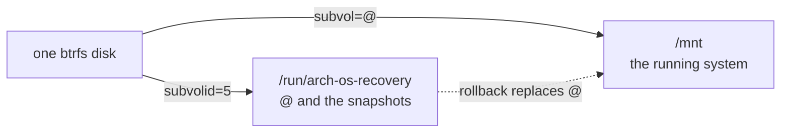

# Arch OS Recovery

Repairs an Arch OS installation. The module is data: one YAML file and a folder per task. The **[runtime](../runtime)** draws the pages, asks the questions and runs the tasks.

**Note:** _Installation: **[➜ Installer](../installer)**. Use and boot: **[➜ Reference](../docs/REFERENCE.md#recovery)**. Script contract: **[➜ Runtime](../runtime/README.md#script-environment)**_

```
make -C .. check                                # load every module, check every script
make -C .. run MODULE=recovery ARGS=--dry-run   # run without touching this machine
```

## Layout

```
module.yaml          settings, actions and tasks in run order
tasks/<id>/task.sh   a task's work
tasks/<id>/test.sh   optional, checks the result on the machine
data/                boot entries, written by the Installer and again by the Recovery, and data/check.sh for boot-tries.sh
```

**Note:** _Functions named in `module.yaml` live in **[lib.sh](../lib.sh)**. Actions shared with the Installer (live system, root, Wi-Fi, ways out, log sharing, shell) live in **[product.yaml](../product.yaml)**. Translations live in **[locales/](../locales)**._

## Stages

Every task after the first is optional.

| Stage | Task | Description |
| --- | --- | --- |
| `open` | `system` | Closes what an earlier attempt left open, unlocks the system and mounts it at `/mnt` as it mounts itself |
| `rollback` | `snapshot` | Replaces the root subvolume with a snapshot, keeps the old one as a snapshot and moves nested subvolumes to the new one. Skipped without snapshots |
| `rebuild` | `boot` | Restores each kernel image from beside its modules, rebuilds the initramfs, restores boot loader and boot entries as the Installer writes them, signs where needed |

**Note:** _`snapshot` and `boot` each confirm, so a run can stop after any task. Both open on **No**, `boot` on **Yes** after a rollback. The last page offers **Open a shell** and opens on **Continue**. Restart and shutdown leave unmounting and locking to systemd._

## Offline

A repair needs only `root` and no network, which may be the broken part. The kernel image comes from beside its modules, where Arch installs it.

`wifi` adds **Connect to Wi-Fi** to the dashboard where there is a card and no wired internet, for an update or a download in the shell. On its partition a cable connects at boot and wins over Wi-Fi, and iwd starts once a card is present. `share-log` uploads the log of a broken script.

## Update

`update` adds **Update the Recovery** to the dashboard where `recovery-to-update` passes: always on its partition, from the ISO only for a disk whose boot image names a UUID the partition no longer has, as after an interrupted update. It ends on **Nothing to update** or opens `update-install`: password on an encrypted disk, confirmation, update. `update-install` requires `online`. **[➜ Reference](../docs/REFERENCE.md#update)**

## Answers

`recovery.conf` beside the started Recovery, never the Installer's file. Only keyboard and disk are asked up front, on its partition neither. Everything else is read or asked later.

| Variable | Source |
| --- | --- |
| `ARCH_OS_RECOVERY_KEYMAP` | Asked `first`, loaded before the first page. Asked again if it fails to load, since the password follows |
| `ARCH_OS_RECOVERY_DISK` | Asked |
| `ARCH_OS_RECOVERY_ENCRYPTED` | LUKS header, no password needed, as `value-from:` |
| `ARCH_OS_RECOVERY_PASSWORD` | Asked right before the run, checked on the disk, never saved |
| `ARCH_OS_RECOVERY_SNAPSHOT` | `@snapshots` on the btrfs top level, asked by the rollback once mounted. Without snapshots the task is skipped |
| `ARCH_OS_RECOVERY_UPDATE_PASSWORD` | Asked by an update on an encrypted disk, checked on the disk, never saved |

| Read | How |
| --- | --- |
| Root partition | Partition 2, a LUKS container or a btrfs labeled `BTRFS` |
| File system | `lsblk` on the unlocked device: btrfs, or the run stops |
| Subvolumes | `btrfs subvolume list` on the top level: all the Installer creates, or the run stops |
| `/boot` | Partition 1 as the Installer lays it out, not the `fstab`, which may be broken |

- Opens only what the Installer of its release series creates
- A derived answer is never asked, never on the dashboard and never in `recovery.conf`. **[➜ Runtime](../runtime/README.md#settings)**
- On its partition the Installer leaves keyboard and language, and the disk is the one it started from. Both values pass their `pattern:` and list like any answer from a file. **[➜ Recovery Partition](../docs/REFERENCE.md#recovery-partition)**

## Mounts

The system at `/mnt` sits on a btrfs top level holding `@` and the snapshots. The top level is mounted separately at `/run/arch-os-recovery`, since a rollback replaces `@` while `/mnt` is unmounted.



**Note:** _Subvolume table and mount options are the Installer's, from `lib.sh`. **[➜ Btrfs Subvolumes](../docs/REFERENCE.md#btrfs-subvolumes)**_

## Requirements

An **Arch Linux live system** and root: `requires:` in `module.yaml`.

**Note:** _Two images qualify: the ISO, and the Recovery image on its own partition, which carries only this module and copies itself to memory first, so its disk opens like any other._
