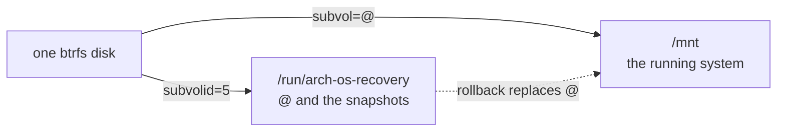

# Arch OS Recovery

Repairs an Arch OS installation. The module is data: one YAML file and a folder per task. The **[runtime](../runtime)** draws the interface, asks the questions and runs the tasks in order.

**Note:** _Installing Arch OS is a separate module: **[➜ Installer](../installer)**_

**Note:** _What it reads and repairs: **[➜ Reference](../docs/REFERENCE.md#the-recovery)**. The task contract: **[➜ Runtime](../runtime/README.md#what-a-script-receives)**._

```
make -C .. check                                # load every module and check every script
make -C .. run MODULE=recovery ARGS=--dry-run   # run it without touching this machine
```

## What Is Where

```
module.yaml          what the Recovery is and asks, its actions, and its tasks in the order they run
tasks/<id>/task.sh   what a task does
tasks/<id>/test.sh   optional: how to tell on the machine that it worked
data/                the boot entries, which the Installer writes and the Recovery lays down again, and data/check.sh, which checks boot-tries.sh
```

**Note:** _Every function `module.yaml` names lives in **[lib.sh](../lib.sh)** beside `product.yaml`. The actions the Installer has too (the live image, root, Wi-Fi, the ways out, sharing the log, the shell) are declared once in **[product.yaml](../product.yaml)**. Every text is translated in **[locales/](../locales)**._

## Stages

Every task after the first is optional.

| Stage | Task | Description |
| --- | --- | --- |
| `open` | `system` | Unlocks the system and mounts it at `/mnt`, the way it mounts itself, after closing whatever an earlier attempt left open |
| `rollback` | `snapshot` | Replaces the root subvolume with a snapshot, keeps the old one as a snapshot and moves every subvolume made inside it to the new. Skipped without snapshots |
| `rebuild` | `boot` | Rebuilds kernel images and initramfs from the package cache, puts the boot loader and the boot entries back as the Installer does, and signs again where needed |

**Note:** _`snapshot` and `boot` each ask for confirmation, so a run can stop after any task. Both open on **No**, `boot` on **Yes** after a rollback. The page the repair ends on offers **Open a shell** in the repaired system and opens on **Continue**. A restart or a shutdown leaves unmounting and locking to systemd._

## No Download for a Repair

The network may be the problem, so a repair never waits for one. Kernel images come from the local pacman cache. A repair needs only `root`.

`wifi` puts **Connect to Wi-Fi** on the dashboard wherever there is a card and no wired internet, for an update or a download in the shell. It is the same action the Installer has. On its own partition a cable connects at boot and is preferred while both are up, and the Wi-Fi daemon starts once a card is present. `restart` and `shutdown` are the ways out. `share-log` uploads the log of a repair with a broken script, for whoever helps.

## Updating Itself

`update` puts **Update the Recovery** on the dashboard wherever `recovery-to-update` passes:

| Started | Offered | Installs |
| --- | --- | --- |
| From its own partition, whose UUID its command line names | Always | The newest release of its series, if newer |
| From the ISO | For a disk whose Recovery does not start: the boot image names a UUID the partition no longer has, as after an interrupted update | The newest release of its series |

Choosing the row checks the releases on GitHub. It ends on **Nothing to update** or opens `update-install`: on an encrypted disk its password, then a confirmation that opens on **No**, then the update. `update-install` needs `online`. Without a network, the error of `update` says how to connect. **[➜ Updating It](../docs/REFERENCE.md#updating-it)**

## Two Questions

Everything else about the disk is read, not asked:

| Read | How | When |
| --- | --- | --- |
| Root partition | The disk's second partition, if it is a LUKS container or a btrfs labeled `BTRFS` | Before the run |
| Encryption | The LUKS header, no password needed | Before the run, as a `value-from:` |
| File system | `lsblk` on the unlocked device: btrfs, or the run stops | Once open |
| Subvolumes | `btrfs subvolume list` on the top level: every one the Installer creates, or the run stops | Once open |
| `/boot` | Partition 1, as the Installer lays it out, not the `fstab`, which may be what broke | While mounting |
| Snapshots | `@snapshots` on the btrfs top level | Mid-run, once mounted, as the rollback task's `asks:` |

Without a snapshot to offer, the task is skipped, not asked.

**Note:** _It opens only what the Installer of its release series makes._

**Note:** _A derived answer is never asked, never shown on the dashboard and never written to `recovery.conf`. The next run reads it again. See `value-from:` in the **[➜ Runtime](../runtime/README.md#settings)**._

## Two Views of One Disk

The system at `/mnt` sits on a btrfs top level that holds `@` and the snapshots. The top level is mounted separately at `/run/arch-os-recovery`, because a rollback replaces `@` while `/mnt` is unmounted.



**Note:** _The subvolume table and the mount options are the Installer's, from `lib.sh`, which both modules load. **[➜ Btrfs Subvolumes](../docs/REFERENCE.md#btrfs-subvolumes)**_

## Answers

`recovery.conf`, beside wherever the Recovery was started. It is the Recovery's own file, never the Installer's.

| Variable | Description |
| --- | --- |
| `ARCH_OS_RECOVERY_KEYMAP` | The console keyboard, asked `first` |
| `ARCH_OS_RECOVERY_DISK` | The disk holding the installation |
| `ARCH_OS_RECOVERY_ENCRYPTED` | LUKS or not: read, never asked |
| `ARCH_OS_RECOVERY_PASSWORD` | Asked right before the run, checked on the disk when entered, never saved |
| `ARCH_OS_RECOVERY_SNAPSHOT` | Asked mid-run by the rollback task |
| `ARCH_OS_RECOVERY_UPDATE_PASSWORD` | Asked by an update on an encrypted disk, checked on the disk, never saved |

Only keyboard and disk are asked up front. The password comes right before the run, the snapshot only if you choose a rollback.

On its own partition neither is asked. The Installer leaves the keyboard it was typed on and the language it was read in, and the disk is the one the Recovery started from. **[➜ The Recovery Partition](../docs/REFERENCE.md#the-recovery-partition)**. Both values go through their `pattern:` and their list, like any answer read from a file. The keyboard is loaded before the first page. A keyboard that fails to load is asked again, since the password is typed next.

## Requirements

A booted **Arch Linux live image**, and root on it: `requires:` in `module.yaml`. Nothing else.

**Note:** _There are two such images: the ISO, and the Recovery image the Installer writes to its own partition, which carries only this module. It copies itself to memory before it starts, so its disk is free to open like any other. **[➜ The Recovery Partition](../docs/REFERENCE.md#the-recovery-partition)**_
